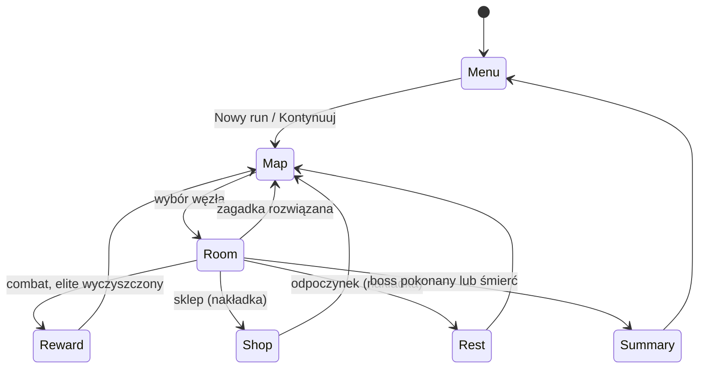

# ADR 0005 — Pętla runu (F3)

Status: **Przyjęta do realizacji (2026-11-14)** — człowiek polecił kontynuować rozwój gry po zamknięciu zadań F2; playtest bramki F2 pozostaje otwarty i może jeszcze zmienić balans. Kontrakty są w `docs/api.md` („Kontrakty F3”, zadanie F3-01 w `docs/issues/F3/README.md`).
Data: 2026-11-14

F3 zamienia arenę F1/F2 w pętlę roguelite: **jeden run = jeden sektor Kurogane Arms** (zgodnie z GDD: 15–25 min, jeden boss). Gracz wybiera ścieżkę po mapie, przechodzi pokoje, zbiera implanty, wydaje Kredyty i kończy na bossie albo ginie. Zasady nadrzędne z `AGENTS.md` bez zmian: symulacja oddzielona od renderu, dane zamiast kodu, `Stats` + `StatModifier`, `EventBus`, `Rng` z seeda, `SaveStore`. Poniższe decyzje ustalają, gdzie przebiega granica między danymi a kodem w pętli runu.

Nazewnictwo: typy węzłów w kodzie i danych są angielskie (`combat`, `elite`, `shop`, `rest`, `puzzle`, `boss`); teksty UI po polsku (walka, elita, sklep, odpoczynek, zagadka, boss) w `src/data/ui/`.

## 1. Mapa sektora: graf warstwowy z seeda

Mapa to **warstwy (8)** po 2–4 węzły; krawędzie prowadzą tylko do **sąsiednich** węzłów **kolejnej** warstwy. Wyjątki wynikające z reguł: warstwa 8 (boss) ma jeden węzeł, a warstwa 7 (przedostatnia) to wyłącznie `rest`. Warstwa 1 to wyłącznie `combat`.

```ts
type NodeType = 'combat' | 'elite' | 'shop' | 'rest' | 'puzzle' | 'boss';
interface MapNode {
  id: string;
  layer: number;
  index: number;
  type: NodeType;
  next: string[];
} // id np. 'L3N1'
interface SectorMap {
  sectorId: string;
  layers: MapNode[][];
} // zapisywana w całości w RunState
function generateSectorMap(def: SectorDefinition, seed: string): SectorMap; // new Rng(seed).fork('map')
```

Generacja (`src/world/sectorMap.ts`, funkcja czysta, tylko `Rng.fork('map')`):

1. Liczba węzłów warstwy: `rng.int(min, max)` z `nodesPerLayer`.
2. Krawędzie: pozycja węzła `x = (index + 0.5) / n`; każdy węzeł łączy się z najbliższym (po `x`) węzłem następnej warstwy, a z drugim najbliższym z szansą `extraEdgeChance`. Naprawa: węzeł bez wejścia dostaje krawędź od najbliższego węzła poprzedniej warstwy. Krawędzie się nie przecinają (sprawdza test).
3. Typ węzła: ważony los z `typeWeights` dla przedziału warstw (`Rng.pick` na tablicy ważonej), potem **gwarancje i limity** z danych: np. ≥ 1 sklep i ≥ 2 elity w warstwach 3–6, `maxPerLayer` dla elity i zagadki, najwyżej `maxElitesPerPath` elit na jednej ścieżce. Naruszenie naprawia się zamianą węzła na `combat` (deterministycznie, w kolejności id).
4. Dane `src/data/sectors/kurogane.json` (zod): `layers`, `nodesPerLayer`, `extraEdgeChance`, `typeWeights`, `guarantees`, `limits`, `expectedDurationS` (na typ), `threat` (pkt 3), `rewardWeights` i `economy` (pkt 7), `roomPools` (id pokoi na typ).

**Długość runu.** Szacunek z danych: `expectedDurationS` = combat 150, elite 210, shop 60, rest 45, puzzle 90, boss 300. Test: suma po ścieżce mieści się w 15–25 min (900–1500 s) dla ≥ 95% ścieżek na 200 seedach. To tylko proxy; długość realnego runu ocenia człowiek na bramce.

## 2. Pokoje: ręcznie zrobione moduły w danych

`src/data/rooms/*.json` w formacie układu areny (`src/data/scenes/arena.json`: `playerSpawn`, `blocks`, `director`) rozszerzonym o to, czego pętla runu potrzebuje:

```ts
interface RoomDefinition {
  id: string;
  name: string;
  type: NodeType; // type decyduje o puli (sector.roomPools)
  playerSpawn: Vec3;
  blocks: { size: Vec3; position: Vec3; model?: string }[]; // jak arena.json
  spawnPoints: { x: number; z: number }[]; // punkty spawnu wrogów (≥ 4 dla combat/elite)
  doors: { id: string; role: 'entry' | 'exit'; position: Vec3; size: Vec3 }[];
  director?: DirectorConfig; // tokeny ataku/strzału, jak w arena.json
  maxAlive?: number;
  minSpawnDistance?: number;
  props?: { kind: string; position: Vec3 }[]; // skrzynie (Chwyt), terminal
  puzzle?: PuzzleDefinition; // tylko type 'puzzle'
}
```

- **Drzwi** to czarne bloki świata (obiekt interaktywny w stylu): `entry` zamyka się po wejściu gracza, `exit` otwiera się po `room_cleared` (usunięcie collidera).
- **`playerHealth` znika z układu** — zdrowie pochodzi z `RunState`.
- Walidacja zod i testy układu: punkty spawnu poza blokami i w granicach, osiągalność punktów spawnu od `playerSpawn` (flood fill siatki 1 m), jedna para drzwi `entry`/`exit` (boss: tylko `entry`).
- **Sklep i odpoczynek** to małe pokoje fizyczne. Po wejściu automatycznie otwiera się nakładka UI (kursor zwolniony, brak nowego klawisza interakcji); „Wyjdź” zamyka nakładkę i otwiera drzwi `exit`.
- **Zagadka:** pokój z Chwytem — skrzynie rejestrowane przez `GrabPhysics.registerObject`, gracz układa je tak, by dosięgnąć terminala (`reachZone`). Priorytet niski: nie blokuje bramki F3, może przejść do backlogu; do tego czasu `typeWeights.puzzle = 0`.
- `src/data/scenes/arena.json` zostaje bez zmian — to poligon.

## 3. Budżet zagrożenia i fale pokoju

Nowe pole `threatCost` w `src/data/enemies/*.json` (`enemySchema`: opcjonalne w schemacie, test wymusza je dla każdego wroga bez bossa). Wartości startowe do strojenia z `npm run balance`: assaulter 1, drone 1, gunner 1,5, shielder 2,5, sniper 2,5, executor 6.

```
budżet = (threat.base[type] + threat.perLayer[type] × (layer − 1)) × room.threatMultiplier
```

`planWaves(room, sector, node, rng)` (`src/world/threat.ts`, `Rng.fork('room:<nodeId>')`) zwraca **`WavesDefinition` zgodną z istniejącym `wavesSchema`**, więc `WaveDirector` działa bez zmian:

1. Liczba fal z `threat.waveCount[type]` (combat 2–3, elite 2–3), budżet dzielony wagami fal (rosnące).
2. Wrogowie losowani z puli typu (`threat.pools[type]`, wagi) z ograniczeniem `threatCost ≤ pozostały budżet` i odblokowaniem od warstwy (`threat.unlockLayer`, np. snajper od 3, Egzekutor od 4).
3. Elita: w jednej z fal gwarantowany Egzekutor; reszta z budżetu.
4. `spawnPoints`, `maxAlive`, `minSpawnDistance` z pokoju; limit `tuning.arena.maxEnemies` pozostaje twardym sufitem.

Boss nie używa budżetu — ma własny pokój i wzorce (pkt 8).

## 4. Każdy pokój = nowy świat Rapier i nowa instancja sceny

Pokój to nowy `RoomScene` z nowym `World` (`world.free()` w `dispose`, jak w `Arena`). Stan międzypokojowy przenosi wyłącznie serializowalny `RunState`:

```ts
interface RunState {
  seed: string;
  sectorId: string;
  loadoutId: string;
  startedAtMs: number;
  elapsedS: number; // czas symulacji, nie zegar ściany
  map: SectorMap;
  currentNodeId: string | null;
  visited: string[];
  hp: number;
  energy: number; // ciepło broni nie jest przenoszone (broń startuje zimna)
  credits: number;
  implants: string[]; // id implantów, bez duplikatów
  stats: {
    kills: number;
    damage: { melee: number; power: number; gun: number; other: number };
  };
}
```

- **`RunManager`** (`src/world/run.ts`, bez Three.js i DOM) trzyma `RunState`, maszynę ekranów (`map | room | reward | shop | rest | summary`), nalicza Kredyty i statystyki ze zdarzeń; testowalny w Vitest.
- **`RunScene`** (`src/scenes/run.ts`, `?scene=run`) jest meta-sceną implementującą istniejący `Scene`: tworzy i niszczy `RoomScene`, przekazuje mu `ctx` z `rng` pochodnym (`fork('room:<nodeId>')`) i ten sam `bus`, pokazuje ekrany UI. **`main.ts` nie przełącza scen** — `EventBus`, `GameLoop`, `FeelSystem` i `AudioSystem` żyją przez cały run, a „nowy run”, „kontynuuj” i „powrót do menu” to przejścia przez URL (`?scene=run&seed=…&loadout=…`, `?scene=run&continue=1`, `/`), czyli świeża strona.
- **`RoomScene`** buduje ten sam skład co `Arena` (świat, `DamageSystem`, `StatusSystem`, `ProjectileSystem`, `EnemyManager`, gracz, ostrze, moce, bronie, `SynergySystem`, odłamki). Dla `RunState` potrzebne są: `Health.set(n)` (nowa metoda: dziś jest tylko `heal` i `reset`), `PlayerEnergy.set` (istnieje), nałożenie implantów na `Stats`. Wyodrębnienie wspólnego rdzenia z `Arena` jest dozwolone tylko, jeśli testy areny przechodzą bez zmiany asercji; inaczej `RoomScene` powiela skład, a deduplikacja trafia do backlogu.
- **Dwie instancje `Stats`.** W `Arena` bazowe statystyki walki (`maxHealth`, `damage`, `maxEnergy`…) żyją w `playerStats`, a `dashCooldown` i `moveSpeed` w `PlayerController.stats`. Implanty nakładamy na obie instancje (`removeBySource` też na obu); każda czyta tylko własne statystyki, więc nadmiarowy modyfikator jest nieszkodliwy.
- **Zabójstwa → Kredyty.** `enemy_killed` nie niesie archetypu, więc `RoomScene` mapuje id encji na archetyp (`EntityRegistry.kind` zwraca dziś `definition.kind`, równe id wbudowanych wrogów) i woła `RunManager.creditKill(threatCost)`.
- **Śmierć:** `player_died` w pokoju → `RunManager.finish('death')` → `run_ended` → `clearRun()` → ekran podsumowania → menu. Arena F1/F2 z „Jeszcze raz” zostaje bez zmian.

## 5. Zapis runu

`SaveStore` ma już `saveRun/loadRun/clearRun` (`RunSave { saveVersion, seed, startedAt }`). F3 rozszerza `RunSave` o `run: RunState` i podnosi `SAVE_VERSION` do 2 z migracją 1→2.

- **Kiedy:** `saveRun` przy każdym wejściu na ekran mapy (po wybranej nagrodzie, sklepie, odpoczynku); `clearRun` przy `run_ended`. Podczas walki nie zapisujemy.
- **Co:** cały `RunState` razem z mapą, a nie sam seed — zmiana wag w danych sektora nie rozjedzie wznowionego runu.
- **Wznowienie:** odświeżenie strony w pokoju cofa do ostatniego zapisu na mapie (pokój trzeba przejść ponownie; te same fale dzięki `Rng.fork('room:<nodeId>')`, ta sama oferta nagrody dzięki `Rng.fork('reward:<nodeId>')`). Zakup w sklepie i zdrowie po nim są cofnięte razem z Kredytami, więc nie da się tego wykorzystać.
- **Meta-progres osobno:** `saveMeta` bez zmian (F4). `metaSchema` i `runSchema` dzielą dziś `SAVE_VERSION` i tablicę migracji, więc migracja 1→2 musi być dla `meta` neutralna; zapis v1 runu (szkielet F0, bez stanu) migracja traktuje jako brak runu. Zapis z nowszej wersji pozostaje nietknięty (istniejące zachowanie `isFuture`).

## 6. Implanty per run, `Stats` i synergie na tagach

`src/data/implants/*.json` (zod), jeden plik na implant:

```ts
interface ImplantDefinition {
  id: string;
  name: string; // name: tekst UI (pl)
  rarity: 'common' | 'rare' | 'epic' | 'legendary';
  tags: string[]; // '#melee', '#power', '#gun', '#elektrycznosc', …
  modifiers: Omit<StatModifier, 'source'>[]; // stat ∈ STAT_IDS
  triggers?: {
    when: SynergyWhen;
    effects: SynergyEffect[];
    cooldownS?: number;
  }[]; // SynergyWhen: typ ze whenSchema w synergies.ts
  upgradesTo?: string; // id implantu o jedną rzadkość wyżej
}
```

- **Nakładanie wyłącznie przez `Stats`** ze źródłem `implant:<id>` (`add` / `removeBySource`). Nikt nie liczy bonusów samodzielnie.
- **Wyzwalacze** używają tych samych `when` i `effects` co synergie (`add_energy`, `cool_weapon`, `stat_modifier_timed`, `chain_on_hit`), więc nowy implant z efektem to dane, nie kod.
- **Tagi i progi.** `SynergySystem.setTags(tags)` już przyjmuje tablicę; F3 liczy wystąpienia tagów z ekwipunku (`Loadout.tags`) i implantów, a definicja synergii zyskuje opcjonalne `requiresCount: Record<tag, liczba>` (próg liczby tagów). Dotychczasowe `requires` działa jak dziś (każdy tag ≥ 1), więc istniejące synergie i testy się nie zmieniają.
- **`maxHealth` flat/percent:** wzrost maksimum dodaje różnicę do bieżącego zdrowia (inaczej implant „+HP” nic by nie dawał do czasu odpoczynku).
- **Unikalność:** ten sam implant nie występuje dwa razy w runie. **Ulepszenie** (odpoczynek) zastępuje implant jego `upgradesTo` (schemat sprawdza, że to dokładnie następna rzadkość).

## 7. Nagrody i ekonomia

- **Wybór 1 z 3** po pokoju `combat` i `elite`: trzy różne implanty niemające jeszcze gracza, rzadkość z `rewardWeights[typ pokoju]` (elita ma lepsze wagi), losowanie `Rng.fork('reward:<nodeId>')`, zdarzenie `reward_offered`. Po bossie nagrody nie ma — jest zwycięstwo.
- **Kredyty:** waluta runu, naliczana z zabójstw (`threatCost × economy.creditsPerThreat`, bonus za elitę), bez pickupów. Znikają po runie (meta-waluty Dane i Rdzenie to F4).
- **Sklep:** 3 implanty (cena zależna od rzadkości, `Rng.fork('shop:<nodeId>')`) i leczenie (cena za `economy.shopHealFraction` maksymalnego zdrowia).
- **Zagadka:** zamiast nagrody dodatkowe Kredyty (`economy.puzzleCredits`).
- **Odpoczynek:** leczenie o `economy.restHealFraction` **albo** ulepszenie wybranego implantu o jedną rzadkość.
- **Brak pasywnej regeneracji zdrowia** (GDD): zdrowie rośnie wyłącznie w odpoczynku i sklepie (oraz przy ewentualnych efektach implantów). Test regresji pilnuje, że `RunManager` nie leczy sam.

## 8. Boss: Dyrektor Ochrony Kurogane Arms

Osobny archetyp `kind: 'boss'` (klasa `Boss` w `src/enemies/boss.ts`, rejestr w `src/enemies/registry.ts`), dane `src/data/enemies/securityChief.json`. **Fazy z danych** (progi HP), każda z listą wzorców:

| Wzorzec                           | Mechanizm                                                                                                                                                                  | Kontra                    |
| --------------------------------- | -------------------------------------------------------------------------------------------------------------------------------------------------------------------------- | ------------------------- |
| Telegrafowane uderzenie obszarowe | `enemy_telegraph` (`kind: 'slam'`), obrażenia w promieniu po telegrafie                                                                                                    | dash, wyjście z promienia |
| Wachlarz pocisków                 | pociski przez `ProjectileSystem` z tagiem `#gun`, więc parowalne i odbijalne                                                                                               | parowanie, Bariera        |
| Wezwanie Tarczowników             | `EnemyManager.spawn('shielder', …)` z limitem `maxMinions`                                                                                                                 | flank, ciężki cios, Chwyt |
| Faza tarczy łamanej               | `DamageTargetOptions.guard` (F2-14) zeruje obrażenia; tarcza traci wytrzymałość od obrażeń z tagiem `#power` i od odbitych pocisków; po złamaniu ogłuszenie i okno obrażeń | moce, parowanie           |

- Progi faz nie da się przeskoczyć jednym ciosem: obrażenia są ucinane na progu, a przejście daje krótką nietykalność (`phaseShiftS`) i zdarzenie `boss_phase`.
- Wybór wzorców z `Rng` z seeda pokoju; telegrafy zawsze przed obrażeniami (filar czytelności).
- **Pokój bossa** (`type: 'boss'`): bez `WaveDirector`; `room_cleared` po śmierci bossa, potem `run_ended` ze zwycięstwem. Pasek HP bossa w HUD (`boss_spawned`, `health_changed`, `boss_phase`).

## 9. UI i przepływ ekranów

HTML/CSS nad canvasem (`src/ui/`), teksty w `src/data/ui/*.pl.json`. Menu główne: **Nowy run** (wybór buildu istniejącym `BuildSelect`, opcjonalny seed), **Kontynuuj** (aktywne tylko przy `loadRun() ≠ null`), **Arena / poligon** (`?scene=arena`). Dotychczasowa lista scen debug zostaje dostępna w trybie debug.



Ekran podsumowania: czas, zabójstwa, pokoje, osiągnięta warstwa, implanty, obrażenia według ścieżki (z tagów `#melee`, `#power`, `#gun` w `damage_dealt`).

## 10. Nowe zdarzenia (propozycja do `docs/api.md`, bez edycji teraz)

Konwencja jak dotąd: czasy w sekundach z sufiksem `S`.

| Zdarzenie          | Payload                                                                   | Emituje         |
| ------------------ | ------------------------------------------------------------------------- | --------------- |
| `node_selected`    | `{ nodeId: string; type: NodeType }`                                      | `RunManager`    |
| `room_entered`     | `{ nodeId: string; roomId: string; type: NodeType; layer: number }`       | `RoomScene`     |
| `room_cleared`     | `{ nodeId: string; type: NodeType; timeS: number }`                       | `RoomScene`     |
| `reward_offered`   | `{ nodeId: string; options: readonly string[] }` (id implantów)           | rewards         |
| `implant_acquired` | `{ id: string; rarity: Rarity; source: 'reward' \| 'shop' \| 'upgrade' }` | `ImplantSystem` |
| `currency_changed` | `{ currency: 'credits'; amount: number; delta: number }`                  | `RunManager`    |
| `shop_purchase`    | `{ item: string; kind: 'implant' \| 'heal'; price: number }`              | shop            |
| `rest_used`        | `{ choice: 'heal' \| 'upgrade'; implant: string \| null }`                | rest            |
| `boss_spawned`     | `{ id: EntityId; name: string; maxHealth: number }`                       | `Boss`          |
| `boss_phase`       | `{ id: EntityId; phase: number; phases: number }`                         | `Boss`          |
| `run_ended`        | `{ outcome: 'victory' \| 'death'; summary: RunSummary }`                  | `RunManager`    |

Istniejące `run_started { seed }` zostaje; od F3 emituje je `RunManager` przy nowym runie i wznowieniu (dziś `main.ts` emituje je przy każdym starcie sceny — zadanie F3-07 ogranicza to do scen innych niż `run`).

## Rozważone alternatywy

| Decyzja                                            | Alternatywa                                        | Dlaczego nie                                                                                                              |
| -------------------------------------------------- | -------------------------------------------------- | ------------------------------------------------------------------------------------------------------------------------- |
| Graf warstwowy z wyborem ścieżki                   | Liniowa sekwencja pokoi                            | Brak decyzji przy wyborze ścieżki, mniejsze znaczenie buildu i ryzyka                                                     |
| Graf warstwowy                                     | Otwarty graf lub mapa swobodna                     | Droższe UI i generator, trudniejsze gwarancje długości runu                                                               |
| Ręcznie zrobione moduły pokoi                      | Pokoje proceduralne (BSP, WFC)                     | Czytelność i styl wymagają kontroli, testy układów prostsze; koszt to liczba pokoi (łagodzony punktami spawnu i budżetem) |
| Nowy świat Rapier na pokój                         | Jeden ciągły świat z doładowywaniem pokoi          | Wycieki ciał i stanu, trudniejszy zapis; koszt to czas ładowania (cache modeli, ekran przejścia)                          |
| Zapis tylko na mapie                               | Snapshot symulacji w trakcie walki                 | Serializacja wrogów, pocisków i Rapier jest poza zakresem; gubi tylko postęp pokoju                                       |
| Zapis całej mapy                                   | Regeneracja mapy z seeda przy wczytaniu            | Zmiana danych sektora między wersjami rozjeżdża wznowiony run                                                             |
| Budżet zagrożenia (`threatCost`)                   | Ręczne listy fal na pokój (jak `waves/arena.json`) | Nie skaluje się z głębokością i typem pokoju, każdy pokój wymagałby ręcznego balansu                                      |
| Implanty: dane + `Stats` + wspólne efekty synergii | Implanty jako kod specjalny                        | Łamie zasadę „nowy wariant = nowy plik danych”                                                                            |
| Ulepszenie przez `upgradesTo` (osobne definicje)   | Jedna definicja z `tiers`                          | Tiery komplikują schemat i dobór nagród; osobne pliki są proste i testowalne                                              |
| `RunScene` jako meta-scena + przejścia przez URL   | Globalny host scen w `main.ts`                     | Host zmienia cykl życia całej aplikacji; świeża strona gwarantuje czysty `bus` i brak wycieków                            |
| Boss jako osobny archetyp z fazami z danych        | Fala z jednym silnym wrogiem                       | Brak faz, tarczy i wezwań; boss to wzorce, nie statystyki                                                                 |
| Sklep i odpoczynek jako pokój + nakładka           | Czyste ekrany bez pokoju                           | Dwa różne tryby przejścia; pokój zachowuje jeden przepływ drzwi                                                           |

## Konsekwencje

- **Plus:** pętla runu składa się z istniejących klocków (`WaveDirector`, `SynergySystem`, `SaveStore`, `Rng.fork`); nowe pokoje, implanty i sektory to dane. Wszystko jest deterministyczne dla seeda, więc mapę, nagrody i fale testuje Vitest bez przeglądarki.
- **Minus / ryzyka:**
  - **Czas ładowania pokoju** (nowy `World`, modele `.glb` ładowane przy budowie układu): cache modeli i ekran przejścia; test, że `world.free()` jest wołane.
  - **Wycieki subskrypcji `EventBus`** między pokojami (`AudioSystem`, `FeelSystem` żyją cały czas, `Hud` i systemy sceny nie): test liczy handlery po `dispose` trzech pokoi.
  - **Duplikacja składu `Arena` w `RoomScene`**, jeśli wspólny rdzeń nie przejdzie testów areny bez zmian.
  - **Balans:** `threatCost`, ceny i wagi to wartości startowe; sumy HP i obrażeń do przeliczenia przez `npm run balance`; długość runu ocenia człowiek.
  - **Zakres:** zagadka i część zawartości pokoi mogą przejść do backlogu bez blokowania bramki.
- **Bramka F3 (testowalna):** pełny run 15–25 min z bossem; śmierć wraca do menu z podsumowaniem; bot e2e na stałym seedzie przechodzi całą mapę z cheatami w < 2 min; test deterministyczności mapy (ten sam seed daje identyczną `SectorMap`, nagrody i fale).

## Poza zakresem F3

Meta-progres, kryjówka, Dane i Rdzenie (F4); misje i pozostali bossowie (F5); freeplay (F6); znalezione w runie bronie i moduły broni (backlog); implanty warunkowe od stanu (np. „+30% obrażeń przy pełnej energii” wymaga nowego wyzwalacza, backlog); wiele sektorów w jednym runie; replay z seeda.

## Konsekwencje dla kontraktów (`docs/api.md`, dopisać w F3-01 po akceptacji)

- Typy: `NodeType`, `MapNode`, `SectorMap`, `SectorDefinition`, `RoomDefinition`, `ImplantDefinition`, `Rarity`, `RunState`, `RunSummary`, `RunSave.run`.
- Zdarzenia z pkt 10 w `GameEvents`.
- `Health.set(n)`, `enemySchema.threatCost`, `SynergyDefinition.requiresCount`, `SAVE_VERSION = 2` z migracją, `tuning.run` (czas przejścia, wygaszenie).
- `RoomPlanner` (interfejs planowania pokoju dla `RunScene`), komendy debug `run …`, `credits`, `implant`.
