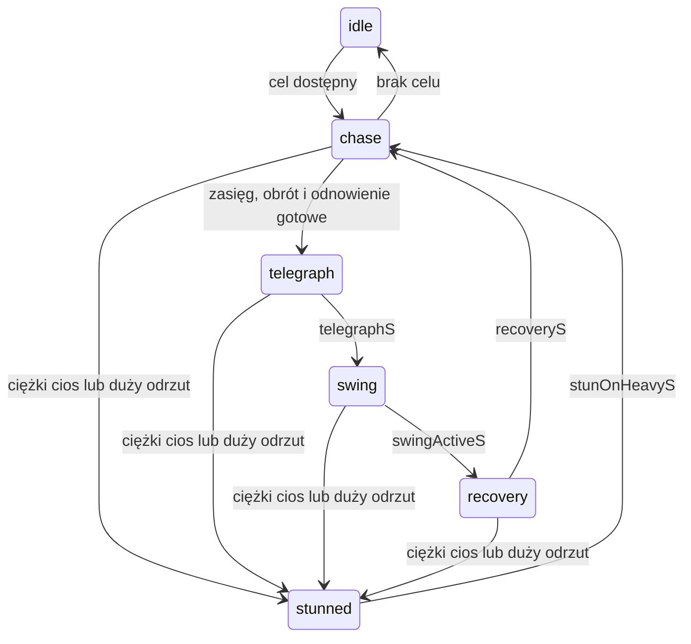

# Wrogowie — F1 #08–09

## Nawigacja, ruch i animacja

Tryb areny ustala cel wroga. W jednym wsadzie na krok `EnemyManager` przekazuje
pozycje XZ i indeksy komórek do modułu Rust/WASM. Na arenach warstwowych
każda trasa schodzi po polu odległości w ustalonej kolejności. Z jej prefiksu
wróg wybiera najdalszy widoczny węzeł. Skrót sprawdza krawędzie siatki na
bieżącej powierzchni, a kapsuła o promieniu `navigationClearanceM` wzdłuż
odcinka może dotykać wyłącznie komórek tej powierzchni, połączonych krawędziami
siatki. Odcinek obok narożnika ściany lub krawędzi pomostu jest więc odrzucany
także dla pozycji ciągłych, a wróg idzie do środka najbliższej komórki trasy.
Węzeł pośredni jest oznaczany `moveGoalFinal = false`: wróg nie hamuje przed nim
i nie uznaje go za cel trybu (`goalStopM` dotyczy tylko celu końcowego).
Pola odległości celu są buforowane po 32 (FIFO), w TS i w Rust.
Między poziomami prowadzą krawędzie grafu schodów i ramp. Sojusznicy zachowują
własne `path/next`. Szczegóły pomiaru i dystrybucji zawiera ADR 0012.

Lista kandydatów do separacji zachowuje kolejność spawnu. W chwili ruchu
każdej kapsuły symulacja sprawdza rzeczywisty dystans i kierunek od sąsiada.
Jeśli w trakcie kroku ktoś pojawi się lub przemieści dalej niż margines listy,
pozostali aktorzy sprawdzą pełną grupę. Odrzut jest osobną składową prędkości.
Dron po kontakcie ze ścianą usuwa składową prędkości skierowaną w przeszkodę.
Pozostały ruch rzutuje na płaszczyznę kontaktu i sprawdza drugim przelotem
kuli, dzięki czemu może kontynuować orbitę także wzdłuż ukośnej ściany.

`tuning.enemies.pathLookaheadCells` ustala długość prefiksu.
`accelerationMps2` i `brakingMps2` ograniczają zmianę wektora prędkości.
Profil `locomotionScale` w danych skaluje te limity dla archetypu.
Prędkość dojścia uwzględnia drogę hamowania w krokach symulacji,
a `turnRateDegS` ogranicza obrót także w marszu do punktu trybu.
Krok symulacji oblicza kierunek ciała i przechył. Widok interpoluje je razem
z pozycją i prędkością. Humanoid miesza klipy idle, chodu i biegu według
prędkości. Kość kręgosłupa (lub tułów modelu zastępczego) kompensuje różnicę
między kierunkiem korpusu i celowania; laser Snajpera i tarcza zastępcza
(Boss, Tarczownik bez modelu) podążają za kierunkiem celowania, nie korpusu.
Wejście w chód z aktywnego klipu spoczynkowego nie wygasza go (bez T-pozy).
Boss hamuje do zasięgu ataku, nie do pozycji gracza. Limity przechyłu i skrętu tułowia są
w `tuning.enemies.turnLeanRad` i `torsoAimLimitRad`, dostępne w panelu debug.

Sprawdzenie w 30 sekund: `?scene=conquest&arena=arenaPowerPlant&seed=bench-ai&debug=1`.
Włącz `god` i użyj `tp 25 -25 180`. Obserwuj grupę między turbinami
i pomostami, zwłaszcza mijanie się, obrót na narożniku i hamowanie przy celu.

## Z16 — Wieżyczka i Dron-haker

| Pole                  | Wieżyczka (`turret`)                                | Dron-haker (`hacker`)               |
| --------------------- | --------------------------------------------------- | ----------------------------------- |
| HP / koszt zagrożenia | 70 / 3                                              | 24 / 2,5                            |
| Ruch / obrót          | stacjonarna / 45°/s                                 | 4,5 m/s / 360°/s                    |
| Zasięg                | 20 m                                                | 15 m, dystans preferowany 9 ± 2,5 m |
| Telegraf / odnowienie | 0,9 s / 2 s po serii                                | 1,2 s / 5 s                         |
| Atak                  | 3 pociski po 10 obrażeń co 0,3 s, 60 m/s, życie 4 s | wiązka 2 obrażeń i `jammed` na 3 s  |
| Chwyt / odrzut        | nie / odporność 1                                   | tak (5 kg) / odporność 0            |

Wieżyczka (`Turret extends Gunner`) korzysta z maszyny stanów Strzelca; `stationary` pomija ruch,
grawitację kontrolera i separację oraz odrzut, zachowując punkt spawnu. Zamiast pasma
`preferredRange ± rangeTolerance` zaczyna celowanie, gdy cel jest widoczny, w zasięgu
`attackRange` (20 m) i głowica jest obrócona w jego stronę (`turnRateDegS` 45°/s); nie unika doskoku
(`dash_used`) i nie szuka osłony. Dane muszą mieć `stationary: true`, `grabbable: false`, `knockbackResist: 1`
(walidacja schematu). Rozrzut `spreadDeg` = 0.
Pole `moveSpeed: 1` spełnia dotychczasowy dodatni schemat, ale nie powoduje
ruchu. Pociski lecą zgodnie z yaw głowicy, ograniczonym także podczas serii;
laser pokazuje ten sam kierunek. Podstawa jest nieruchoma, głowica z lufą
obraca się. Materiały `enemy`/`enemyGlow` zachowują czerwień i obrys.
Kontry: flankowanie, parowanie zwykłego pocisku `#gun`, Wykończenie;
Pchnięcie zadaje obrażenia i może ogłuszyć, ale nie przesuwa.

Haker dziedziczy lot, kolizje i tokeny strzału Drona. Lata na 2,6 m,
krąży z prędkością 25°/s. W telegrafie zawisa i śledzi gracza czerwoną
linią. Po telegrafie (`hack.hackTelegraphS` 1,2 s, stan `aim`; potem jedno „strzelenie” w `burst`)
raycast długości `attackRange` (15 m) po grupach World i Player musi trafić hurtbox gracza (sensory
bez hurtboxu są pomijane); ściana blokuje wiązkę. Obrażenia (tag `#hack`, kwota ze `Stats.damage` = 2)
i status `jammed` (`hack.durationS` 3 s) idą przez `DamageSystem`, zatem nietykalność,
śmierć i osłony nie przepuszczają zagłuszenia. Kolejny telegraf możliwy po `hack.hackCooldownS` = 5 s
od strzału. Każde obrażenie otrzymane w stanie `aim` przerywa telegraf (przejście w `cooldown`)
i rozpoczyna pełne 5 s odnowienia (także przy ogłuszeniu); w pozostałych stanach nie ma wpływu.
Kontry: strzał przerywający zapowiedź, broń dystansowa, Błyskawica.
Widok używa istniejącego `enemy_drone` i proceduralnej anteny (`drone.antenna`:
ciemny maszt z poprzeczką, czerwony talerz, świecący pierścień nadajnika i czubek),
również w wariancie zastępczym. Wieżyczka (`TurretView`) jest proceduralna: ośmiokątny
cokół na trzech wspornikach, kolumna z pierścieniem światła, obrotowa głowica
(`turretHead`) z osłonami bocznymi, dwiema lufami (`barrel`) od przodu obudowy do
`muzzle` z danych i okiem czujnika (`eye`), które pulsuje w stanie `aim`; po strzale
lufy cofają się o 6 cm (czysto wizualne stałe w widoku). Wszystko pozostaje czerwone.

Kurogane: haker ma wagę 1 w combat i elite; wieżyczka 1 w combat i 2 w elite.
Istniejący wspólny `unlockLayer.turret: 4` odblokowuje ją od warstwy 4
w obu pulach. Zmiana pul zmienia składy dla dawnych seedów; deterministyczność
dla jednakowych danych i seeda pozostaje. Nie zmieniono asercji zapisanych fal.

Arena (Z18): Dron-haker występuje w falach 5, 8 i 10 po 1 sztuce oraz w fali
12 w 2 sztukach. Wieżyczka występuje w falach 6, 9 i 11 po 1 sztuce oraz w fali
12 w 2 sztukach. Pierwsze cztery fale i punkty spawnu pozostają bez zmian.
Test `arenaTurretSpawns.test.ts` sprawdza na rzeczywistej arenie, że z każdego
punktu wieżyczka może ostrzelać gracza w dostępnej części areny bez ruchu
własnego. Widoczność zależy od pozycji gracza: filary i niskie osłony nadal
blokują linię strzału; nie każdy punkt obejmuje pozycję startową gracza zasięgiem.

Komendy `spawn turret 1` i `spawn hacker 1` używają istniejącego rejestru
w pokoju, arenie i ai-test. Testy: `enemiesZ16.test.ts`, `threat.test.ts`,
`hud.test.ts`, `status.test.ts`. Pokój, arena i ai-test przekazują
`statuses: this.statuses` w zależnościach mocy (patrz `docs/api.md`).
Test headless w `roomScene.test.ts` sprawdza, że `jammed` gracza odmawia
Pchnięcia z `power_denied.reason: 'jammed'` bez kosztu energii, a po wygaśnięciu
pozwala użyć mocy. Raport `docs/balance.md` obejmuje oba nowe archetypy;
bramka TTK paczki ×5 w otwartej przestrzeni przechodzi bez strojenia ich danych.
Ocena wyglądu i feel należy do Architekta; nie wykonano Playwrighta ani buildu.

## Chwyt i przejęcie ciała (F2-09)

`enemySchema.grabbable?: boolean` określa podatność na Chwyt. Brak pola oznacza
odmowę. Szturmowiec, Strzelec, Snajper, Dron, Dron-haker i Tarczownik mają `true`;
Egzekutor, Wieżyczka i boss mają `false`. Nie jest to status: system mocy nie nakłada bezpośrednio
ogłuszenia ani innych statusów.

`Enemy.grabTarget?()` (wszystkie wbudowane archetypy poza bossem) udostępnia ciało Rapiera,
masę i `setControlled(boolean)`; `EnemyManager.grabTargets()` filtruje martwych
i usuniętych. Przejęcie natychmiast przerywa telegraph/swing/aim/burst, usuwa
aktywny hitbox, punkt celowania i token lub oczekiwanie w kolejce dyrektora.
Snapshot `controlled` jest `true` podczas chwytu i lotu. Wrogowie odczytują
wtedy pozycję z fizyki, bez własnego ruchu, ataków i próśb o token. Tarczownik
opuszcza tarczę, więc rzut i trafienia podczas przejęcia przechodzą normalnie.
Kapsuły mają zablokowany obrót, aby dynamiczny lot nie przechylał kontrolera.
Po `world.step()` scena wywołuje `manager.captureControlled()`, aktualizując
bieżące snapshoty przed interpolacją; model nie zostaje o krok za wiązką.

Dron przy przejęciu czasowo zmienia swój hurtbox z sensora w ciało kolidujące;
po zwolnieniu przywraca sensor. Trafienie lecącą skrzynią w normalnie latającego
Drona jest wykrywane przelotem kształtu także wobec sensora. Lądowanie kończy
przejęcie i przywraca `idle` żywemu wrogowi; od kolejnego kroku działa zwykłe AI
(Dron wraca na swój pułap). Statusy, jeśli nadal aktywne, ponownie ograniczają
AI zwykłą ścieżką. Śmierć nie jest nadpisywana przez `idle`.

Podczas `controlled` handlery obrażeń nie uruchamiają odrzutu ani zmiany stanu;
same obrażenia i statusy nadal działają. Zwolnienie od razu zachowuje aktywne
ogłuszenie z `StatusQuery`, a parowanie Egzekutora jest wyłączone podczas
przejęcia. Kolejny Chwyt pomija wroga już przejętego przez dowolną instancję.
Dron ma jawną `drone.massKg` = 5 kg (limit chwytu i masa fizyczna). Po przejęciu
jego ciało odzyskuje odstęp `skinM` od świata, dzięki czemu może wznieść się
z podłogi przy ścianie i wznowić orbitę. Nie zmienia to zwykłej pracy AI.

Reset mocy przywraca typ ciała i CCD przed usunięciem wrogów przez scenę.
Śmierć lub despawn przejętego celu odłącza go od Chwytu natychmiast.
Testy: `grabPower.test.ts`, scena: `?scene=grab-test`; dotychczasowe testy AI
zachowują asercje.

Szturmowiec (`assaulter`) naciera z pałką elektryczną. Ma 60 HP, porusza się
z prędkością 4,2 m/s, zatrzymuje się 1,8 m od celu i zapowiada cios przez 0,4 s.
Aktywny wymach trwa 0,12 s i zadaje 15 obrażeń przez `Hitbox` oraz `DamageSystem`.
Źródłem zdarzenia `damage_dealt` jest encja wroga. Jeden wymach trafia cel raz;
odejście poza zasięg lub poza obszar przed wrogiem pozwala uniknąć ciosu.

## Dane i rejestr

`src/data/enemies/*.json` ładowane są przez rejestr i walidowane `enemySchema`
z zod. `id` określa wariant, `kind` wybiera implementację archetypu.
`enemyRegistry` to mapa id → fabryka; `availableEnemyIds()` podaje dostępne id,
a `createEnemy(ctx, deps, id, position)` tworzy wroga. Nieznane rodzaje,
powtórzone id i niepoprawne dane zatrzymują ładowanie.

Wspólne pola: `maxHealth`, `moveSpeed`, `turnRateDegS`, `attackRange`,
`telegraphS`, `swingActiveS`, `recoveryS`, `cooldownS`, `damage`,
`knockbackResist` (0–1), `stunOnHeavyS`, `repathJitter`.
Blok `body` zawiera geometrię kapsuły ruchu, hurtboxów i ciosu, odstęp kontrolera
oraz tłumienie odrzutu. Blok `animation` zawiera długość kroku, kąty kończyn,
przechył ogłuszenia i pulsowanie pałki. Te bloki są opcjonalne w schemacie
ogólnym; Szturmowiec wymaga `body`, a jego dane dostarczają również `animation`.
Zdrowie, prędkość oraz obrażenia korzystają ze `Stats`.

## Symulacja i maszyna stanów

`Assaulter` nie importuje Three.js i nie dotyka DOM. `step(dt)` działa w stałym
kroku symulacji; `dt=0` nie zmienia stanu. Snapshoty `previous/current`
przechowują pozycję stóp, yaw, stan, czas stanu, prędkość i przebytą drogę.

Przejście `chase → telegraph` wymaga ponadto tokenu `melee` dyrektora (gdy scena go ma, patrz niżej),
obrotu do celu w obrębie jednego kroku obrotu i `cooldown` = 0. Dodatkowe przejścia do `stunned`:
zdarzenie `melee_parried` z wrogiem jako atakującym (parowanie gracza; stun `tuning.melee.meleeParryStunS`
i odrzut `meleeParryKnockback × (1 − knockbackResist)`) oraz status `stunned`. Unik przed ciężkim ciosem
gracza (`melee_swing`, stage `heavy`) wraca ze stanów `idle`/`chase`/`telegraph` do `chase` (opis w `difficulty.md`).
Z flagą `controlled` (Chwyt) wróg nie wykonuje własnego kroku.
Wejście w `telegraph` emituje `enemy_telegraph { id, kind: 'swing', durationS }`
(`kind: 'heavy'`, gdy `attackTags` zawiera `#heavy`, np. Egzekutor).
Kierunek ciosu zostaje ustalony przy zapowiedzi: wróg nie śledzi celu podczas
telegrafu ani wymachu. Zapytanie Rapiera przed wrogiem wybiera hurtbox gracza;
przed trafieniem sprawdzany jest też dystans do aktualnej pozycji celu.
Odnowienie `cooldownS` zaczyna się przy wejściu w `recovery` i biegnie równolegle
z regeneracją po ciosie. Wróg może ponownie zapowiedzieć atak dopiero po obu.

Pościg obraca wroga z ograniczeniem `turnRateDegS`. Promień na wysokości ciała
sprawdza ściany w `tuning.enemies.wallProbe`; przeszkoda wywołuje ruch boczny.
Stronę i odstęp kolejnego sprawdzenia wybiera strumień wroga (`fork('ai')` strumienia spawnu, patrz „Determinizm”).
`repathJitter` rozprasza momenty kolejnych prób. To lokalne omijanie przeszkód,
bez pathfindingu grafowego. Sąsiedzi z managera odpychają się wewnątrz
`tuning.enemies.separationRadius`; kolizje kapsuł dodatkowo ograniczają nakładanie.
Separacja działa również podczas ataku i ogłuszenia. Gdy spawn umieści kapsuły
w tym samym miejscu, filtr kontrolera pozwala im wyłącznie oddalać się od siebie
do chwili rozdzielenia; później przywraca zwykłe kolizje.

## Wspólne ciało i obrażenia

`EnemyBody` udostępnia ruch po ziemi z grawitacją, próbę ściany i odrzut.
Kinematyczna kapsuła w `CollisionGroup.Enemy` współpracuje z character controllerem
Rapiera. Dwa dodatkowe sensory przyjmują obrażenia: kapsuła tułowia ×1 i kula
głowy ×1,5. Wszystkie collidery są związane z encją przez `EntityRegistry`;
tylko sensory należą do `Hurtboxes`. Ciało i hurtboxy poruszają się razem.
Scena wykonuje **jeden** `world.step()` po krokach gracza i managera.

`damage_dealt` dla własnego id dodaje impuls z pola `knockback`,
skalowany przez `1 - knockbackResist`, z wykładniczym tłumieniem z danych.
Kierunek pochodzi z `dir`; przy `null` można go odtworzyć z pozycji celu będącego
atakującym. Nieznany kierunek pomija sam odrzut. Tag `PIERCE_BLOCK_TAG`
lub impuls co najmniej `tuning.enemies.stunKnockback` przerywa aktualny atak,
przełącza stan na `stunned` i emituje `enemy_stunned { id, durationS }`.
Ponowne ogłuszenie odświeża czas. Ogłuszony wróg nie atakuje.

Mocny impuls lub kierunek w górę nadaje chodzącym prędkość pionową
(`knockbackLiftRatio`, `knockbackMaxLiftSpeed`). Przy rzeczywistym kontakcie
ze ścianą Rapier podaje punkt i normalną. Jeśli odrzut w stronę ściany ma co
najmniej `wallSlamMinSpeed`, składowa normalna odbija się z `wallSlamBounce`.
Zderzenie dodaje `wallSlamExtraStunS` do ogłuszenia, zadaje obrażenia `#wall`
i wyzwala `enemy_wall_slam`, iskry, wstrząs kamery i hitstop. Drony korzystają
z istniejącego testu kolizji kuli ze światem.

Zdarzenie `enemy_killed` z `DamageSystem` przełącza dowolny stan na `dead`.
Collidery ruchu i hurtboxy są usuwane podczas obsługi zdarzenia. Model humanoida
lub drona pochyla się i przesuwa w kierunku ostatniego trafienia przez
`deathCollapseS` (0,14 s), po czym ustępuje miejsca głównej fali odłamków.
Egzekucja i śmierć wieżyczki używają natychmiastowego rozpadu. Po
`tuning.enemies.corpseS` manager sprząta pozostałe zasoby wroga.

`EnemyManager`: `spawn(id, position)`, `step(dt)`, `forEach(cb)`, `despawnAll()`,
`dispose()`, `grabTargets()`, `captureControlled()`, `setSpawnModifiers(mods)`, pola `difficulty` i `director`.
Utrzymuje wspólną listę sąsiadów, wywołuje AI w kolejności spawnu, usuwa zwolnione
instancje, a dopiero potem krokuje dyrektora (`director.step(dt)`). `despawnAll()` zeruje licznik spawnów
i resetuje dyrektora. Sam nie krokuje świata ani `DamageSystem` — robi to właściciel.
`EnemyDependencies.spawnEnemy` (dla wezwań bossa) deleguje do `spawn`.

Wrogowie z `moveGoal` (tryb Podboju, `docs/systems/modes.md`) maszerują do celu, dopóki gracz jest dalej niż
`tuning.modes.conquest.detectRangeM` (lub `carry.defendRangeM` przy nośniku Skoku), bez taktyk i bez tokenów;
`setCarry` dodaje modyfikator `moveSpeed` typu `mult` ze źródłem `heistCarry`.

### Determinizm (Rng)

`Rng` to generator 32-bitowy (mulberry32: `state += 0x6D2B79F5`, mieszanie jak w `core/rng.ts`);
`fork(label)` = nowy `Rng` z ziarna `hashSeed("<ziarno liczbowe rodzica>:<label>")`, niezależny od liczby
losowań rodzica. Wrogowie: `manager.spawn` tworzy `ctx.rng.fork('spawn:<n>')` (`n` od 0, rośnie z każdym spawnem,
zerowane przez `despawnAll`), a wróg bierze z niego `fork('ai')`. Dyrektor ma osobne `fork('coordination')`.
Kolejność losowań wroga (zmiana kolejności zmienia przebieg tego samego seeda):

- Dron/haker: w konstruktorze `chance(0.5)` (kierunek krążenia: sukces = +1); w `fire`: `float(−s, s)` yaw, potem pitch;
  dron przy wyborze drogi z narożnika losuje `float(0, 2π)` jako przesunięcie kątowe próbek.
- Strzelec/Snajper/Wieżyczka: wejście w `reposition` — `chance(0.5)` (strafe); `fire` — yaw, potem pitch (`float(−s, s)`);
  próba ściany `steer`: `float(0, repathJitter)` po każdej próbie; osłona: `chance(coverUse)`, potem `float(0, 2π)`;
  unik doskoku: `chance(dashDodgeChance)`, `chance(0.5)`; początek okna presji: `chance(groupAttack)`;
- Szturmowiec/Tarczownik/Egzekutor: próba ściany — `chance(0.5)` (strona omijania) tylko gdy ściana, i zawsze `float(0, repathJitter)`;
  flankowanie: `chance(flankChance)`, `chance(0.5)`, `float(flankMinDeg, flankMaxDeg)`; unik: `chance(heavyDodgeChance)`;
- boss: `pick(wzorce dostępne w danej chwili)` przy rozpoczęciu wzorca; przy wezwaniu `shuffle(punkty spawnu)` lub `float(0, 2π)` (pierścień).

## Render i animacja

`EnemyView` ładuje GLB wskazany przez `definition.model` do cache i klonuje
szkielet przez `SkeletonUtils.clone`. Każdy humanoid ma własny `AnimationMixer`,
kości i akcje; geometria, materiały stylu oraz `AnimationClip` są współdzielone.
`applyStyle` obejmuje `SkinnedMesh`; standardowe materiały stylu i normalne
obsługują skinning także w przebiegach obrysu i bloom. Materiały źródłowe są
zwalniane po stylizacji, a zasoby szkieletu pojedynczego klona przy `dispose()`.
Brak modelu lub `loadModels=false` zachowuje animację proceduralną zastępczych
brył. Dron nadal korzysta z `DroneView`.

Model patrzy w +Z. Pozycja i yaw interpolują się według `alpha`, z najkrótszą
drogą obrotu. Czysta funkcja `selectEnemyAnimation` wybiera klip ze snapshotu:

| Stan                        | Klip                                                      |
| --------------------------- | --------------------------------------------------------- |
| Bezczynność / recovery      | `Idle_Loop`; strzelcy `Pistol_Idle_Loop`                  |
| Chase / reposition z ruchem | `Walk_Loop` do połowy `moveSpeed`, powyżej `Jog_Fwd_Loop` |
| Telegraph                   | `Sword_Idle`; Tarczownik `Punch_Enter`                    |
| Swing                       | `Sword_Attack`; Tarczownik `Punch_Cross`                  |
| Aim / cooldown strzelca     | `Pistol_Aim_Neutral`                                      |
| Burst                       | `Pistol_Shoot`, ponawiany przy resecie `shotTimeS`        |
| Stunned                     | `Hit_Chest`, jednorazowo                                  |
| Controlled                  | `Hit_Head`, jednorazowo (ogłuszenie ma pierwszeństwo)     |
| Dead                        | kierunkowy upadek, potem rozpad na odłamki                |

Tempo ruchu to `clip.duration * speed / stride`, gdzie `stride` to `animation.clipStrideM[klip]` (droga stóp na cykl w metrach świata: Walk 1,41 / Jog 4,61 dla modelu Szturmowca, Strzelca, Snajpera i Tarczownika, 1,69 / 5,54 dla modelu Egzekutora, razy `modelScale`; test `enemyStride.test.ts` mierzy je w GLB), a bez wpisu `animation.strideM` (też faza chodu brył zastępczych)
(`strideM` = droga na cykl klipu chodu w metrach świata, u bossa 1,69 m × `modelScale`
1,5; `animation.jogFromSpeedFrac` zmienia próg chodu i biegu, boss ma 2 = zawsze chód,
bo `Jog_Fwd_Loop` ma ok. 5,5 m na cykl i przy tym tempie ślizgałby stopy). Klipy jednorazowe
mają `LoopOnce` i zatrzymują ostatnią pozę; cios dopasowuje czas do
`swingActiveS`, przygotowanie Tarczownika do `telegraphS`, reakcja na ogłuszenie
do `stunOnHeavyS`. Pozostałe klipy są zapętlone. Przenikanie ma
`tuning.enemies.animationFadeS` = 0,12 s oraz
`animationActionFadeS` = 0,04 s dla akcji jednorazowych; oba pola pojawiają się
w istniejącym panelu lil-gui.

Mixer dostaje przyrost interpolowanego `stateTimeS` snapshotów symulacji,
więc Skupienie spowalnia go, a hitstop i pauza zatrzymują. Zmiana stanu resetuje
bazę zegara. Widok nie używa czasu ściennego ani `frameDt`. Aktualizacja jest
odroczona do `Mesh.onBeforeRender`: tylko siatka dopuszczona do rysowania
uruchamia mixer, raz na render mimo wielu przebiegów postprocessu. Pozycje
kości i macierze skina są odświeżane przed rysowaniem. Konserwatywna sfera
skina obejmuje ruch kończyn; niewidoczny model nie nadrabia pominiętych klatek.

**Boss** (`kind: 'boss'`): w pościgu zegar stanu płynie (wcześniej `transition('chase')`
w każdym kroku zerował `stateTimeS`, więc mixer dostawał dt = 0 i boss „pływał”
w zastygłej pozie). Snapshot niesie `attack { kind, telegraphS, recoveryS }` bieżącego
wzorca; `boss.attackAnimations[kind]` (`clip`, `impact`, `end`, ułamki klipu) mapuje
go na animację: zapowiedź rozciąga odcinek [0, `impact`] na `telegraphS`, tak że poza
uderzenia przypada na chwilę skutku w symulacji (efekt i obrażenia), a wymach z regeneracją
([`impact`, `end`], `swingActiveS + recoveryS`) kontynuują tę samą akcję bez resetu.
`end = impact` zatrzymuje pozę (wezwanie i tarcza: miecz wzniesiony). Model `enemy_executor`
ma tylko klipy mieczowe, więc `slam` i `fan` używają `Sword_Attack` (uderzenie w
podłogę przy 0,36 i zamach poziomy przy 0,30), a `summon`/`shield` jego fazy wzniesienia
miecza (0,15). Pociski wachlarza wylatują z `boss.muzzle` (przed bossem, na wysokości
ostrza w zamachu), nie z klatki piersiowej. Do zmiany po dodaniu dedykowanych klipów
(strzał, wezwanie, tarcza) wystarczy edycja danych.

Recoil `rifle`, pulsowanie `visor` / `baton_tip`, widoczność `shield`, ostrze
Egzekutora i `boss.modelScale` nadal działają. W zapowiedzi wręcz pulsuje także
`visor` (Szturmowiec, Tarczownik) oraz `visor` i `chest_core` (Egzekutor, boss), więc
rozbłysk widać również wtedy, gdy broń zasłania tułów. Siatki z `mat_enemy_glow`,
ostrze Egzekutora i lasery celowania mają `userData.noOutline` (bez ciemnego konturu),
żeby z odległości czytały się jak źródła światła. Żadne klipy nie sterują AI,
hitboxami, czasem zadawania obrażeń ani rozpadem.

Testy: `enemyAnimation.test.ts` (wybór klipów), `enemySkeleton.test.ts`
(rzeczywiste GLB, skin, kości, wyposażenie, budżet, celowanie, 30 klonów,
przenikanie i czas świata), `enemyView.test.ts` (fallback i cache).

## Scena ai-test i weryfikacja

`?scene=ai-test&debug=1` zawiera arenę z osłonami `cover_low`, filarem `pillar`
i dwoma Szturmowcami oraz jednym Strzelcem. Konfiguracja sceny jest w `src/data/scenes/aiTest.json`,
walidowana zod. Gracz korzysta z `PlayerController` i `FpsCamera`, ma 100 HP,
hurtbox kapsuły oraz nietykalność po trafieniu z `tuning.damage.playerInvulnMs`.
Napis HTML pokazuje HP. Śmierć resetuje gracza i wrogów po 1 s symulacji;
reset zeruje także okno nietykalności. `dispose` usuwa napis i subskrypcje.

- `spawn <id> [n]`: wróg lub grupa 8 m przed graczem.
- `hit <dmg>`: obrażenia wszystkim wrogom, źródło gracz, tag `#debug`.
- `kill all`: zabija wszystkich przez `DamageSystem`.
- `god`: przełącza `damageTaken` ×0 przez modyfikator `Stats`; działa od razu.
- `reset`: reset sceny przez istniejący mechanizm debug.
- Query: `enemies` (żywi), `enemyStates` (id i stan żywych), `playerHp`.

W 30 sekund: otwórz scenę, pozwól wrogom podejść i odskocz podczas uniesienia
pałki. Oceń czytelność 0,4 s zapowiedzi, ruch wokół filara i okno po ciosie.
Włącz `god`, użyj `spawn assaulter 2`, następnie `hit 1000`; licznik ma spaść do 0.

`tests/unit/enemies.test.ts` korzysta z prawdziwego Rapiera w Node: dane, fabryka,
hurtbox głowy, pościg, czasy ataków, pudło po odejściu, hitstop, odrzut,
ogłuszenie, śmierć, separacja i deterministyczne omijanie ściany.
`aiTest.test.ts` sprawdza scenę, komendy, god, reset po śmierci i sprzątanie.
`enemyView.test.ts` sprawdza interpolację, animację, klonowanie i cache GLB.
`tests/e2e/aiTest.spec.ts` sprawdza ładowanie bez błędów konsoli oraz spawn/kill,
czekając na kroki symulacji przez `waitSimSteps` i `SIM_TIMEOUT`.

## Dodawanie wariantu i archetypu

Wariant istniejącego Szturmowca: dodaj JSON w `src/data/enemies/` z nowym `id`
i `kind: 'assaulter'`, pozostałymi polami, `body` i `animation`. Rejestr wykryje
plik automatycznie; `spawn <nowe-id>` działa bez zmiany kodu zachowania.

Nowy archetyp: rozszerz schemat o potrzebne pola opcjonalne, dodaj
implementację interfejsu `Enemy` i fabrykę dla nowego `kind` w `registry.ts`.
Może korzystać z `EnemyBody`, istniejącego managera i własnego widoku.
Dodaj dane, testy i scenę w zakresie zatwierdzonego zadania. Kontrakty nowych
zdarzeń zatwierdza Architekt w `docs/api.md` przed implementacją.

## Strzelec — F1 #09

`gunner` jest drugim archetypem w rejestrze. `src/data/enemies/gunner.json`
ustala 45 HP, prędkość ruchu 3,4 m/s i preferowany dystans 9 m z tolerancją
2 m (pasmo 7–11 m). Pola dystansowe są opcjonalne dla innych archetypów;
walidator wymaga ich i `body` dla `kind: 'gunner'`. Dane Szturmowca pozostają poprawne.
`maxHealth`, `moveSpeed` i obrażenia pocisku przechodzą przez `Stats`.

Cykl: `idle → reposition → aim → burst → cooldown → reposition`.
Z bliska Strzelec odchodzi, z daleka podchodzi, dodając lekki ruch boczny
(`strafeScale`). Stronę i rozrzut wybiera wyłącznie własny strumień
strumień wroga (`fork('ai')`). Korzysta z `EnemyBody`, separacji sąsiadów oraz
istniejącej próby ściany `tuning.enemies.wallProbe`.

W paśmie z widocznym celem, obrócony do gracza (w obrębie jednego kroku obrotu) i — gdy scena ma
dyrektora — z tokenem `shot`, zatrzymuje się i emituje
`enemy_telegraph { id, kind: 'aim', durationS: 0.5 }`. Przez całe 0,5 s
celuje i obraca się do gracza, dopiero potem oddaje trzy strzały co 0,22 s
(z dokładnością do stałego kroku). Każdy strzał mierzy w aktualną pozycję celu
z rozrzutem ±2° (`spreadDeg` po skalowaniu trudnością) na osiach yaw i pitch (dwa losowania `float(−s, s)`: yaw, potem pitch).
Po serii odpoczywa `cooldownS` = 1,6 s (stan `cooldown`; Strzelec zamiast tego może pójść w osłonę, patrz `difficulty.md`).
Ogłuszenie przerywa zapowiedź lub serię; obsługa odrzutu, śmierci i usuwania
ciała jest taka jak u Szturmowca.

Przy `losRequired: true` raycast Rapiera sprawdza `CollisionGroup.World`
od ciała do wylotu i od wylotu do celu. Brak widoczności przerywa celowanie
lub serię i kieruje Strzelca do celu w stanie `reposition`. Odcinek do wylotu
zapobiega strzelaniu przez osłonę, w którą wszedł model karabinu.

Scena przekazuje wspólny `ProjectileSystem` w `EnemyDependencies.projectiles`
(wymagany przy tworzeniu Strzelca). Pocisk ma `team: 'enemy'`, właściciela
równego id Strzelca, tag `#gun`, prędkość **11 m/s**, obrażenia **12** i czas
życia 4 s. Po `reflect(id, playerId, 'player', dir)` może zranić Strzelca.
Wylot symulacji określa lokalny wektor `muzzle` w danych; nie zależy od renderu.

`EnemyView` ładuje i klonuje `enemy_gunner.glb`, stosuje `applyStyle` i zachowuje
czerwony fallback z karabinem i wizjerem. Model ze skinem używa klipów
`Pistol_*` i chodu opisanego wyżej; fallback nadal obraca ramiona proceduralnie.
Widoczny `visor` i `muzzle` pulsują. `shotTimeS` ponawia klip strzału i uruchamia
odrzut `rifle`, także po ostatnim strzale serii. Parametry recoil i pulsowania
pozostają w JSON, czasy przenikania w `tuning.enemies`.

`ai-test` ma jedną pulę pocisków i `ProjectileRenderer` z `InstancedMesh`.
Scena krokuje pociski po `world.step()`, render interpoluje pozycje i ustawia
orientację wzdłuż lotu. Pociski wrogów używają `enemy_projectile.glb`,
`enemyGlow` i skali 1,6; przy braku modelu pozostaje większa bryła zastępcza.
Reset czyści aktywne pociski, a dispose usuwa pulę i zasoby renderu.

Kontrola w 30 sekund: `?scene=ai-test&debug=1&seed=gunner`, `kill all`,
`spawn gunner 1`. Sprawdź pulsowanie wizjera przed serią, widoczność wolnych
pocisków i możliwość zejścia z toru lotu. Podejdź bliżej niż 7 m, potem odejdź
ponad 11 m; wróg powinien odzyskać dystans. Osłoń się filarem — nie powinien
strzelać przez ścianę. `god` pozwala obserwować kolejne serie bez śmierci.

Testy Rapiera w `enemies.test.ts` obejmują dane obu archetypów, dystans,
zapowiedź, serię, LOS, prędkość i obrażenia pocisku, odbicie, deterministyczność
oraz przerwanie serii przez ogłuszenie. `aiTest.test.ts` sprawdza pociski sceny
i ich czyszczenie przy resecie, a `enemyView.test.ts` — osobny cache Strzelca,
celowanie, pulsowanie i odrzut. Playwright `aiTest.spec.ts` sprawdza
`spawn gunner 1` oraz utratę HP od pocisków z wyłączonym `god`, czekając
na kroki symulacji przez `waitSimSteps` i `SIM_TIMEOUT`.

## Dyrektor wrogów — F2-12

`EnemyDirector` (`src/enemies/director.ts`) koordynuje grupę, żeby walka z wieloma
wrogami była czytelna: naraz atakuje tylko kilku, reszta otacza gracza i czeka.
Tworzy go `EnemyManager`, gdy scena poda dane `director`
(`new EnemyManager(ctx, deps, { director })`). Manager wstrzykuje go wrogom
w `EnemyDependencies.director` i woła `director.step(dt)` po krokach wszystkich
wrogów. Bez danych `director` wrogowie zachowują się dokładnie jak w F1.

**Tokeny.** `attackTokens` ogranicza jednoczesne ataki wręcz, `shotTokens` —
jednoczesne celowanie i serie. Wróg, który chce zacząć atak, woła
`requestToken(id, kind)` w każdym kroku. Czekający stoją w kolejce FIFO:
zwolniony token dostaje najdłużej czekający, więc przy `shotTokens: 1` Strzelcy
strzelają na zmianę (ostrzał zaporowy). Zgłoszenie, którego wróg nie ponowił
w kroku, wypada z kolejki. `dt = 0` (hitstop) niczego nie przedawnia. Token
wraca do puli przy `releaseToken`, a sam dyrektor zwalnia go przy `enemy_killed`,
`entity_despawned`, `enemy_stunned` i `status_applied` ze statusem `stunned`.
Bezpiecznik `maxHoldS` odbiera token trzymany zbyt długo.

**Sloty flankowania.** Dwie pule kątów wokół gracza (`slots.melee`, `slots.shot`:
`count`, `offsetDeg` od osi +Z). Kąt przydziela dyrektor, promień podaje wróg:
`slot(id, kind, radiusM)` zwraca punkt na okręgu wokół aktualnej pozycji celu. Kąt slotu `i` to
`offsetDeg + 360 × i / count` stopni od osi +Z, punkt = `cel + (sin kąta, cos kąta) × radiusM` (y celu).
Zasłonięcie sprawdza promień od `cel + (0, probeHeightM, 0)` do punktu slotu (grupy Enemy i World).
Zmiana promienia zapytania zwalnia dotychczasowy slot; koszt dopasowania to kwadrat odległości XZ wroga
od punktu slotu (zaokrąglony do 1e-6), remisy rozstrzyga niższe id wroga, potem niższy indeks slotu.
Pierwszy przydział to najbliższy wolny slot; remis rozstrzyga niższy indeks.
Co `reassignS` przydział liczony jest od nowa zachłannie (pary wróg–slot od
najbliższej), żeby wrogowie nie przebiegali przez gracza, gdy ten zmieni stronę.
Slot zasłonięty przez świat (promień od gracza na wysokości `probeHeightM` nad
jego pozycją, grupa `World`) jest pomijany. Przy braku wolnego slotu `slot`
zwraca `null`. Slot, o który wróg nie zapytał w kroku, zostaje zwolniony.

**Szturmowiec.** W pościgu prosi o token, gdy jest bliżej niż
`flankDistanceM + attackRange` (lub już go ma). Z tokenem naciera i atakuje jak
w F1. Bez tokenu idzie do slotu na promieniu `flankDistanceM` (dane, 4 m), twarzą
do gracza; bez slotu zatrzymuje się na tym promieniu na linii do gracza. Token
trzymają tylko zapowiedź i wymach. Wejście w regenerację, ogłuszenie, śmierć
albo utrata celu go oddaje. `flankDistanceM` musi być większy niż `attackRange`. Punkt flanki podąża za
graczem (przybycie liczone względem bieżącego punktu); marsz do celu trybu
przerywa manewr osłony Strzelca.

**Strzelec.** Prosi o token strzału dopiero, gdy jest w paśmie dystansu, widzi
cel i jest do niego obrócony. Bez tokenu, przy widocznym celu, czeka w slocie
na promieniu `preferredRange`. Bez widoczności działa jak w F1 (podchodzi).
Token trzymają celowanie i seria. Przejście w `cooldown`, utrata widoczności,
ogłuszenie albo śmierć go oddaje.

Dane: blok `director` w pliku pokoju (`RoomDefinition.director`, opcjonalny) lub sceny, m.in. w `src/data/scenes/aiTest.json` (2 tokeny wręcz, 1 strzału)
i `arena.json` (3 i 2 — arena zostaje wymagająca; fale F2 dostroi zadanie 17).
Zapytania debug: `director` w ai-test i `enemyDirector` w arenie zwracają
`snapshot()` (tokeny, kolejki, sloty).

Kontrola w 30 sekund: `?scene=ai-test&debug=1`, `god`, `spawn assaulter 6`, komenda `director` (kto ma tokeny, kto czeka, sloty).
Naraz zapowiada cios najwyżej dwóch Szturmowców, reszta stoi w kręgu ok. 4 m
i przesuwa się za graczem. `kill all`, `spawn gunner 3`: Strzelcy rozstawiają
się wokół i strzelają seriami po kolei, nie razem. Ocena feel: czy krąg nie
wygląda sztywno i czy przerwy między atakami nie są za długie.

Testy: `tests/unit/director.test.ts` (logika tokenów i slotów bez fizyki oraz
Szturmowcy i Strzelcy w prawdziwym Rapierze: limit ataków, rotacja tokenów,
krążenie na `flankDistanceM`, naprzemienne serie, zwolnienie przy ogłuszeniu
i śmierci, walidacja danych) i `aiTest.test.ts` (dyrektor z danych sceny).

**Statusy (F2-02).** `EnemyDependencies.statuses` (z `StatusSystem` sceny):
status `stunned` przełącza wroga w stan `stunned` na czas trwania statusu
(emisja `enemy_stunned`, zwolnienie tokenu dyrektora). Szczegóły: `docs/systems/status.md`.

## Snajper i Dron — F2-13

**Snajper** (`sniper.json`, `kind: 'sniper'`) to archetyp Strzelca z innymi
danymi — ta sama klasa `Gunner`, model i animacja. Trzyma dystans 16 m ± 3,5
(z bliska odchodzi), celuje 1,6 s z widoczną linią lasera, przez ostatnie
`aimLockS` = 0,35 s cel jest zamrożony (laser grubieje ×`laserLockScale`), potem
oddaje jeden strzał 30 obrażeń z tagami `projectileTags: ['#gun', '#heavy']`:
blok ostrzem go nie osłabia, trzeba zejść z linii po zamrożeniu albo sparować.
Nowe opcjonalne pola Strzelca: `aimLockS` (krótszy niż `aimTelegraphS`),
`laserSight`, `projectileTags` (domyślnie `['#gun']`), w `animation`:
`laserRadiusM`, `laserLockScale`. Snapshot ma `aim` (punkt celowania)
w stanach `aim` i `burst`; bez `aimLockS` cel jest śledzony do końca serii
jak w F1. Po zamrożeniu Snajper patrzy w zamrożony punkt i nie przerywa strzału, nawet gdy straci
widoczność celu. Laser rysuje `EnemyView` w przestrzeni lokalnej widoku: od `muzzle`
z danych do `aim`, tylko w stanie `aim`.

**Dron** (`drone.json`, `kind: 'drone'`, klasa `Drone`) lata bez character
controllera: kinematyczne ciało z sensorem-kulą (hurtbox `radiusM`,
`hurtboxMultiplier`) na stałej wysokości `hoverHeightM` nad punktem spawnu.
W `reposition` i `cooldown` krąży wokół celu w odległości `preferredRange`
z prędkością kątową `orbitSpeedDegS` (kierunek z `Rng`), w `aim`/`burst` wisi
w miejscu. Strzela seriami jak Strzelec (pola `gunnerFields`, token `shot`
dyrektora, widoczność promieniem do celu). Każdy ruch to `world.castShape`
kuli po grupie `World` z odstępem `skinM`. Dron ślizga się wzdłuż ściany
i odwraca kierunek krążenia, gdy ruch stanął. Odwrócenie blokuje kolejne na
`cornerEscape.orbitReverseLockS` (0,25 s). Po kontakcie ze ścianą dron mierzy
przesunięcie w poziomie w oknie `stuckWindowS` (0,4 s). Utknięcie to przesunięcie
poniżej `stuckDistanceM` (0,2 m) lub przekroczenie `maxOrbitReversals` (1) w oknie.
Dron sprawdza `sampleCount` (24) równomiernie rozłożone punkty orbity z przesunięciem
kątowym z własnego `Rng`. Sprawdza drogę kulą o promieniu `radiusM` z zapasem
`skinM / 2` i leci do najbliższego dostępnego punktu bez odwracania orbity.
Zapamiętuje punkt do dotarcia, również podczas celowania i strzału. Gdy nie znajdzie
przejezdnej drogi, wraca do zwykłego krążenia i ponawia wybór po kolejnym wykryciu
utknięcia. Odrzut działa w 3D
z tłumieniem `knockbackDamping`; po nim dron wraca na wysokość lotu. Ciężki
cios, duży odrzut i status `stunned` ogłuszają go (przechył, wolne wirniki,
brak strzałów). Pozycja snapshotów to środek drona. Widok `DroneView`
(prymitywy: korpus, oko `enemyGlow`, cztery wirniki; liczby w `drone`
w danych). Sceny tworzą widoki przez `createEnemyView` (`src/enemies/views.ts`).

Kontrola w 30 sekund: `?scene=ai-test&debug=1`, `god`, `kill all`,
`spawn sniper 1` — laser przez 1,6 s, na końcu grubieje; odskocz po
zgrubieniu: strzał chybia. `spawn drone 3` — drony krążą nad graczem,
omijają filar i ściany, strzelają seriami na zmianę. Ocena feel: czy zgrubienie
lasera wystarcza jako sygnał uniku i czy drony nie są za trudne do trafienia
ostrzem (wiszą na 2,6 m).

Sprawdzenie narożnika w tej scenie. Włącz `god` i użyj `kill all`. Stań
około 9 m od narożnika areny, patrząc po przekątnej w jego stronę. Użyj
`spawn drone 1`, podejdź w stronę narożnika i obserwuj, czy dron po kontakcie
z obiema ścianami odleci w głąb areny.

Testy: `tests/unit/sniperDrone.test.ts` — dane, telegraf i śledzenie lasera,
blokada celu (unik po zamrożeniu), ciężki strzał i ucieczka Snajpera; lot
drona na wysokości i krążenie, brak wejścia w ścianę z odwróceniem kierunku,
ślizg wzdłuż pojedynczej ściany, wyjście z narożnika dwóch ścian w 3 s,
serie, ogłuszenie ciosem i statusem, śmierć i sprzątanie, deterministyczność;
`DroneView`, laser w `EnemyView`, `createEnemyView`.

## Tarczownik i Egzekutor — F2-14

Oba archetypy używają `Assaulter`, wspólnego ciała, odrzutu, maszyny stanów
i tokenu `melee` dyrektora. Opcjonalne bloki danych `shield`, `parry` oraz
`attackTags` rozszerzają zachowanie; bez nich Szturmowiec działa jak dotąd.

**Tarczownik** (`shielder.json`, `kind: 'shielder'`): 90 HP, ruch 3 m/s,
cios 12 obrażeń. Podniesiona tarcza blokuje tagi `#gun` i `#melee` w łuku
120° przed wrogiem. Obrona porównuje `-DamageInfo.dir` z kierunkiem patrzenia;
trafienia z tyłu i z boku poza łukiem oraz bez `dir` przechodzą normalnie.
`#heavy` z przodu przechodzi, opuszcza tarczę na `shield.downS` = 3 s
i uruchamia istniejące ogłuszenie ciężkim ciosem. Odliczanie biegnie tylko
w czasie symulacji. Ogłuszenie (stan lub status) i `StatusQuery.has(id,
'overload')` wyłączają tarczę; po ich zakończeniu wraca, jeśli minęło `downS`.
W snapshotach `shieldUp` określa widoczność tarczy.

**Egzekutor** (`executor.json`, `kind: 'executor'`): 220 HP, odporność
na odrzut 0,6, cios 28 obrażeń z `attackTags: ['#melee', '#heavy']`.
Zapowiedź trwa 0,7 s i emituje `enemy_telegraph.kind: 'heavy'`. Paruje lekki
`#melee` raz na `parry.cooldownS` = 2,5 s w stanie `idle` lub `chase`,
jeśli nie jest ogłuszony. Kolejne cięcia w odnowieniu, ciężkie ciosy
i strzały trafiają normalnie. Gdy gracz jest w zasięgu 1,8 m, sparowanie
od razu rozpoczyna zapowiedź kontry skierowanej do gracza. Kontra prosi
o ten sam token `melee` co zwykły atak; brak tokenu pozwala tylko sparować.
Podczas zapowiedzi, wymachu, regeneracji i ogłuszenia Egzekutor nie paruje.

Obie obrony korzystają z `DamageTargetOptions.guard` (kontrakt F2-14); kolejność: tag `#execute` zawsze
przechodzi (Wykończenie), potem tarcza (Tarczownik), potem parowanie (Egzekutor):
blok zwraca 0, nie emituje `damage_dealt`, emituje za to
`melee_blocked { defender, attacker, amount }` z pierwotną kwotą trafienia.
Statusy są nakładane tylko przez zwykłą ścieżkę obrażeń; przeciążenie z mocy
z tagiem `#power` przechodzi przez tarczę.

**Widok:** Tarczownik używa `enemy_shielder`, Egzekutor `enemy_executor`.
Wbudowany węzeł `shield` jest widoczny wg `shieldUp` i **trzymany w lewej ręce**:
`HeldShield` (`src/enemies/heldShield.ts`) wg `animation.shieldHold`
(`bone`, `position` i `rotationDeg` w układzie wroga w pozie `Idle_Loop`,
`rotationFollow`) ustawia go przed lewą połową tułowia (przy przedramieniu
`DEF-forearmL`) i co klatkę, po aktualizacji szkieletu, przenosi środek tarczy
za kością. Ułamek `rotationFollow` obrotu kości przenosi się na tarczę
(1 = sztywne przypięcie; 0,15 — tarcza nie koziołkuje, gdy klipy `Punch_*`
unoszą przedramię). Wcześniejsze przypięcie do kręgosłupa trzymało tarczę 0,6 m
przed postacią, w powietrzu. Pozycja tarczy to wyłącznie prezentacja:
blok z przodu (łuk 120°) liczy `Assaulter`. Gdy model go nie zawiera, pozostaje zastępcza tarcza pod `root`, o wymiarach
`animation.shieldSizeM`. Egzekutor dostaje ostrze `enemyGlow` w `hand_R`,
o rozmiarze `animation.bladeSizeM`, także w GLB. Geometrie dodatków tworzonych
w kodzie są zwalniane z widokiem; geometrie GLB pozostają w cache.

**Kontrola w 30 sekund:** `?scene=ai-test&debug=1`, `god`, `kill all`,
`spawn shielder 1`: strzel lub tnij z przodu, potem zajdź z boku; ciężki
cios powinien odsłonić wroga na 3 s. Sprawdź przeciążenie mocą z tagiem
`#power`. Następnie `kill all`, `spawn executor 1`: lekkie cięcie wywołuje
parowanie i długą zapowiedź ciężkiej kontry; odskocz, potem wykorzystaj
odnowienie parowania. Ciężki cios przerywa kontrę. Ocena feel: czy tarcza
czytelnie znika po wytrąceniu i czy 0,7 s wystarcza na rozpoznanie kontry.

Testy: `tests/unit/shielderExecutor.test.ts` — prawdziwy Rapier, walidacja
i rejestr, przedni łuk i jego granica, flankowanie, ciężki cios, powrót
tarczy, hitstop, przeciążenie i ogłuszenie, brak kierunku, parowanie,
ciężka kontra, odnowienie i token dyrektora; widok fallback i GLB, materiały,
proporcje oraz zwalnianie geometrii. `damage.test.ts` sprawdza kontrakt `guard`.

# Boss — F3-16

`Boss` (`src/enemies/boss.ts`, `kind: 'boss'`) korzysta z `EnemyBody`, `Stats`,
`DamageSystem` oraz wspólnego `ProjectileSystem`. Nie wymaga dyrektora ani budżetu
zagrożenia. Dane `securityChief.json` waliduje blok `enemySchema.boss`:
`name`, `modelScale`, `muzzle`, `phases: [{ hpThreshold, patterns }]`.
Progi oznaczają początek fazy jako ułamek maksymalnego HP; zaczynają się od 1,
muszą ściśle maleć i być dodatnie. Każda faza wymaga co najmniej jednego wzorca.

Dyrektor Ochrony Kurogane Arms ma 900 HP i fazy przy 100%, 65%, 30%.
Obrażenia po modyfikatorach są ucinane na kolejnym progu przez lokalną odmianę
`Health.apply`; niewykorzystana część ciosu przepada. Przejście przerywa zapowiedź
i daje `tuning.enemies.phaseShiftS` nietykalności (domyślnie 1 s, panel debug).
Czas stoi przy `dt = 0`. `boss_spawned { id, name, maxHealth, phaseThresholds }` niesie id, polską nazwę, maksimum HP i progi faz
od drugiej (`hpThreshold` faz 2..n);
`boss_phase { id, phase, phases }` ma fazy numerowane od 1 i pojawia się tylko przy zmianie (dwa razy
w zwykłej walce); `boss_shield { id, current, max }` przy każdej zmianie tarczy. Zmiana fazy
następuje po `damage_dealt`, gdy HP ≤ próg następnej fazy; w nietykalności boss ma stan `recovery`. `health_changed` i śmierć korzystają ze standardowego systemu.

Maszyna: `idle/chase → telegraph → swing → recovery → cooldown → idle`.
Boss podchodzi do `attackRange` (5 m), po czym losuje jeden wzorzec równomiernie (`Rng.pick`) przez
`ctx.rng.fork('ai')` (manager dostarcza strumień konkretnego spawnu). Przed zapowiedzią ustawia
bazowe `damage` w Stats na `damage` wzorca; skutek wzorca następuje przy wejściu w `swing`, po
`swingActiveS` (0,12 s) przychodzi `recovery` (`recoveryS` wzorca), `cooldown` (`cooldownS` wzorca) i `idle`.
W czasie zapowiedzi stoi, a trafienie następuje dopiero po `telegraphS` wzorca.
Status ogłuszenia przerywa zapowiedź; po zakończeniu boss rozpoczyna nowy atak.

- `slam`: `enemy_telegraph.kind: 'slam'`, po zapowiedzi pojedyncze obrażenia
  `#melee`, `#heavy`, jeżeli aktualny środek gracza leży w sferze `radiusM`
  wokół stóp bossa. Dash korzysta z nietykalności celu w `DamageSystem`;
  wyjście z promienia w czasie zapowiedzi unika ciosu.
- `fan`: `enemy_telegraph.kind: 'aim'`, po zapowiedzi symetryczny wachlarz
  `projectileCount` pocisków w `spreadDeg` stopniach, z wylotu `muzzle`
  w kierunku aktualnej pozycji gracza. Prędkość, obrażenia, czas życia i czasy
  wzorca są w JSON. Pociski mają `#gun`, przechodzą przez standardowy interceptor
  ostrza i dają się parować oraz odbijać w bossa. Kolejne fazy zwiększają wachlarz
  z 5 do 7 i 9 pocisków; ostatnia przyspiesza i wzmacnia uderzenie obszarowe.

Widok: istniejący `EnemyView` i `enemy_executor.glb` w skali 1,5; geometria
hurtboxów jest odpowiednio powiększona w danych. Fallback powstaje z tej geometrii.
Po wczytaniu modelu widok dokłada bossowi (`definition.boss`) koronę: świecący
pierścień z ciemnym wewnętrznym okręgiem i siedmioma kolcami za głową oraz pelerynę
z dwóch ciemnych płyt z czerwoną lamówką; części wiszą na kości `DEF-spine003`
(ruszają się z klipami, bez wpływu na hitboxy). Tarcza bossa (`shield`, wymiary
`shieldSizeM`) jest energetyczna: półprzezroczysta czerwień bez zapisu głębi
w świecącej ramie z dwoma pasami skanu.
Zapowiedź pokazuje istniejące uniesienie ramienia i puls ostrza.

Ręczny podgląd: `?scene=boss-test&seed=f3-16` — pusta arena, gracz i jeden boss.
`god` pozwala obserwować wzorce; `boss phase 2` / `boss phase 3` ustawia HP na próg
i uruchamia przejście; `hit 9999` / `kill all` przechodzi najwyżej jeden próg,
po czym trzeba odczekać nietykalność. `spawn securityChief` działa także w
`ai-test`. `query('bosses')` zwraca `{ id, phase, hp }[]` do testów.
Przy ocenie feel sprawdzić czytelność uniesienia ostrza, czas na dash i gęstość
wachlarzy.

## Boss: wezwanie i tarcza łamana — F3-17

Fazy przypisują wzorce w danych: faza 1 `slam` + `fan`, faza 2 dodaje `summon`,
faza 3 dodaje `summon` i `shield`. Schemat wymaga, żeby każda faza miała co najmniej
jeden wzorzec zadający obrażenia (`slam` lub `fan`). Losowanie z `Rng` spawnu wybiera
tylko spośród wzorców dostępnych w danej chwili (`summon` — przy wolnym miejscu i
dostępnym spawnerze, `shield` — gdy tarczy nie ma i nie trwa okno obrażeń). Wzorce
zaczynają się, tak jak pozostałe, gdy gracz jest w `attackRange`.

- `summon` (`enemyId`, `count`, `maxMinions`, `placement`, `radiusM`): telegraf
  `enemy_telegraph.kind: 'summon'`, po nim `EnemyManager.spawn(enemyId, …)` (przez
  `EnemyDependencies.spawnEnemy`). Liczba nowych sług to `min(count, maxMinions −
żywi)`; martwi i usunięci nie liczą się do limitu. `placement: 'spawnPoints'` losuje
  różne punkty spawnu pokoju (`EnemyManagerOptions.spawnPoints`; bez nich albo przy
  `'around'` — pierścień o promieniu `radiusM` wokół bossa, losowy kąt startowy).
  Bez spawnera (np. testy bez managera) wzorzec jest pomijany. Sługi giną razem z
  bossem: w chwili jego śmierci dostają śmiertelne obrażenia (`source: null`, tag
  `#boss_death`), więc rozpadają się standardowym efektem śmierci i nie dają zasług graczowi.
- `shield` (`durability`, `durationS`, `stunS`, `vulnerableS`, `vulnerableMult`):
  telegraf `kind: 'shield'`, po nim tarcza jest aktywna (`current.shieldUp`, widoczna
  płyta w `EnemyView` — zastępcza, bez kierunku). Boss nie przerywa wzorców: dalej
  atakuje (wachlarz można więc odbić). `DamageTargetOptions.guard` zeruje wszystkie
  obrażenia (nawet z progiem fazy). Wytrzymałość maleje o kwotę obrażeń z tagiem `#power`
  oraz o kwotę trafienia pocisku bossa odbitego (parowanie ostrzem, Bariera); pocisk
  gracza z `#gun` jej nie rusza. Obrażenia z tagiem `#debug` (`hit`, `kill all`)
  przechodzą przez tarczę, żeby dało się przejść progi faz. Niezłamana tarcza opada po
  `durationS`; zmiana fazy zdejmuje tarczę, ogłuszenie i okno.
  **Złamanie** przerywa atak, ogłusza bossa na `stunS` (stan `stunned`, zdarzenie
  `enemy_stunned`) i otwiera okno `vulnerableS` (liczone od złamania), w którym
  `damageTaken` ma mnożnik `vulnerableMult` (modyfikator o źródle `boss:vulnerable`).
  Feel: `tuning.enemies.shieldBreakHitstopMs`, `shieldBreakShake`, `shieldBreakShakeS`
  (zdarzenia `hitstop` i `camera_shake`). Nowych zdarzeń nie dodano.

Debug: `boss pattern summon|shield` (boss-test, ai-test, room-test, `?scene=run`)
natychmiast zaczyna wzorzec (telegraf, potem skutek); zadziała też na wzorzec z innej
fazy, jeśli bieżąca go nie ma. `boss phase <n>` jak dotąd. Liczby balansu (tarcza 120,
2 Tarczowników, limit 3, ogłuszenie 2,5 s, okno 5 s ×1,5) są w `securityChief.json` —
do strojenia po playteście. Testy: `boss.test.ts` (część F3-17), `bossRoom.test.ts`.

Testy `boss.test.ts` i `bossTest.test.ts`: schemat i rejestr, progi po
modyfikatorach, nietykalność, kolejność zdarzeń, trafienie w promieniu, przerwanie
ataku, rzeczywiste parowanie i odbicie pocisku przez `PlasmaBlade`, deterministyczne
losowanie, scena i komendy, reset oraz sprzątanie. Kryteria F3-16 nie wymagają e2e.

Fale areny F2 i raport jej balansu nadal obejmują zwykłych wrogów. Test kompletności
fal wymaga archetypów z `kind !== 'boss'`; `runBalance` stosuje ten sam filtr.
TTK z fazami obu bossów podaje osobna tabela w `docs/balance.md`.

## Dyrektor Systemów Orbis Grid

W `?scene=boss-test&boss=orbisDirector&debug=1` Dyrektor ma 720 HP, rig Snajpera
w skali 1,2 i czerwone akcenty na monoklu i pancerzu. Dane ataków i progi HP
pochodzą z `orbisDirector.json`. Na obu progach cios zatrzymuje się dokładnie na
progu, zapowiedź znika i przez `tuning.enemies.phaseShiftS` działa osłona fazowa.

| Faza | Początkowe HP | Co zapowiada Dyrektor                                       | Odpowiedź gracza                                                    |
| ---- | ------------- | ----------------------------------------------------------- | ------------------------------------------------------------------- |
| I    | 100%          | Trzy pociski albo wezwanie dwóch dronów, do trzech żywych   | Blok ostrzem tuż przed trafieniem środkowego pocisku                |
| II   | 65%           | Dochodzą niska linia na wysokości 0,35 m i zakłócenie sieci | Przeskocz linię lub zejdź w bok. Opuść czerwony krąg przed impulsem |
| III  | 30%           | Pięć pocisków, wysoka linia na 1,48 m, drony i zakłócenie   | Prześlizgnij się pod linią i wykorzystaj pauzę po salwie            |

Laser zamraża odcinek przechodzący przez pozycję gracza na początku zapowiedzi.
Trafia raz na jej końcu, według aktualnej pozycji i wysokości kapsuły. Przy
zakłóceniu czerwony krąg wyznacza obszar impulsu, a romb wskazuje przyszłe
położenie bossa. Trafiony gracz otrzymuje `jammed` na 2,2 s. Opuszczenie kręgu
pozwala zachować moce, a Dyrektor przeskakuje na wskazany znacznik.

Trafienie Dyrektora jego własnym odbitym pociskiem przerywa zapowiedź. Przez
2 s można podejść i zadać ×1,5 obrażeń. Czas i mnożnik są w panelu strojenia
pod `enemies.reflectCounterS` i `enemies.reflectCounterMult`.
Okno otwiera się dopiero po faktycznym przyjęciu obrażeń z odbitego pocisku (po
tarczy i obcięciu do progu fazy). Sam odbity pocisk nie dostaje mnożnika, a
trafienie na progu fazy lub zabicie nie otwiera kontry. Ogłuszenie kończy się
razem z oknem.

Zakłócenie wybiera znacznik teleportu najdalszy od gracza i nie bliżej niż suma
promieni kapsuł. Bez znaczników (`spawnPoints`) wzorzec `gridHack` jest pomijany.
Podpowiedzi i znaczniki pól (`BossFieldView`) rysuje na razie tylko `BossTest`,
bo boss nie jest jeszcze w generatorze sektorów. Przed podpięciem do pokoi
trzeba je przenieść do wspólnej oprawy bossa.

Do próby w 30 s służą `boss phase 2` lub `boss phase 3`, a po zgaśnięciu
osłony `boss pattern laser`, `boss pattern gridHack` i `boss pattern fan`.
Porównaj skok z fazy II ze ślizgiem z fazy III. Przy impulsie spróbuj użyć
Bariery (E) przed wygaśnięciem zagłuszenia i po nim. Przy salwie rozpocznij
blok PPM tuż przed kontaktem, a po odbiciu sprawdź, ile czasu zostaje na
podejście i cięcie LPM. `boss ttk` pokazuje pomiar dla wybranego bossa.

## Kontrola modeli CC0 w 30 sekund

`?scene=ai-test&debug=1`, `god`, `kill all`; następnie
`spawn assaulter 1`, `spawn gunner 1`, `spawn sniper 1`, `spawn shielder 1`,
`spawn executor 1`. Obejrzyj sylwetki, płynne przejście chodu w przygotowanie
ciosu i celowanie, broń niesioną przez dłonie oraz tarczę niesioną przez klatkę
piersiową. Włącz Skupienie, sprawdź zatrzymanie ciała przy hitstopie,
po czym `kill all` — ma pozostać rozpad na odłamki. Dla feel zwróć uwagę na
czytelność zapowiedzi, szybki cios w dotychczasowym oknie obrażeń oraz recoil
każdego strzału. Do obciążenia użyj `kill all`, `spawn assaulter 30` i obróć
kamerę od grupy; mixery poza kadrem mają przestać aktualizować kości.

## Przewrócenie i kip-up (S0-08)

Trafienie z odrzutem `knockback >= tuning.enemies.stunKnockback` u humanoidów
chodzących (assaulter, gunner, sniper, shielder, executor; bez dronów, hakera,
wieżyczki i bossa) zapisuje w snapshocie `knockdown` (kierunek odrzutu).
Całe ogłuszenie po przewróceniu
trwa 1,10 s (`tuning.enemies.knockdownStunS`) i daje czas na kolejne trafienie.
Po upadku (0,22 s) wróg leży 0,26 s. Przez kolejne 0,62 s zarzuca nogi za głowę,
wybija się z łopatek, ląduje w przysiadzie i wraca do pozy bojowej. Przy kontakcie stóp
z podłożem pojawiają się iskry. Tarczownik opuszcza tarczę na cały czas ogłuszenia.
Poza z `tuning.vfx.enemyKnockdown` przesuwa i obraca hurtboxy tak, by można było
trafić leżącego wroga. Kapsuła ruchu zachowuje swój kształt. Blisko ściany
wspólne przesunięcie modelu i hurtboxów odsuwa głowę od powierzchni.
Ciężki cios bez przewrócenia (`PIERCE_BLOCK_TAG`) ogłusza na czas z definicji
wroga (`stunOnHeavyS`). Przy ogłuszeniu od takiego ciosu lub od statusu
widok odtwarza `Hit_Chest`.

W `?scene=ai-test&debug=1` użyj `spawn assaulter 3` i `knock`, aby odrzucić
wrogów od gracza. `knock 90` kieruje odrzut wzdłuż osi +X świata.
`timescale 0.1` spowalnia ruch.

## Reakcja widoku na trafienie

Dodatnie, nieśmiertelne obrażenia wyzwalają krótkie wychylenie tułowia lub drona.
`headshot` dodaje wychylenie głowy. Widok nakłada pozę po animacji i wygasza ją
po `enemyFlinchDurationS`. Tik statusu nie wyzwala reakcji. Mikroodrzut broni
działa osobno przez `damage_dealt.knockback`.

W `?scene=ai-test&debug=1` użyj `hit 10` dla flincha, `slam` dla podrzutu
i uderzenia w filar, a `kill all` dla kierunkowego upadku i rozpadu.

## Cel wroga: gracz albo sojusznik

Gdy scena poda `EnemyDependencies.getTargetFor`, `EnemyManager.spawn` daje każdemu wrogowi własne
`getTarget` (wybór `selectHostileTarget`, `docs/systems/allies.md`). Kod archetypów pyta o cel tak
samo jak wcześniej; dyrektor i `targetForward` nadal używają wspólnego `getTarget` (gracz).

W M04 pokój przechowuje rolę sabotażysty przy identyfikatorze wroga. W promieniu
28 m od środka sprawnego wagonu sabotażysta celuje w najbliższą powierzchnię
hurtboxa na połowie wysokości pudła. Pocisk lub cios musi fizycznie trafić.
Gracz w odległości poniżej 5 m od sabotażysty lub gracz zadający mu obrażenia
przejmuje uwagę na 4 s czasu symulacji. Kolejny bodziec odnawia ten czas.
Poza zasięgiem wagonu i po zakończeniu eskorty wraca zwykły wybór celu drużyny.

## Wykrywanie

Spotkanie z polem `stealth` tworzy strażników z osobną warstwą czujności. `EnemyManager` aktualizuje ją przed krokiem archetypu. Patrol używa istniejącego celu marszu, a cel walki staje się dostępny przy namierzeniu. W zwykłych starciach manager przekazuje archetypom dotychczasowe zależności. Model, strojenie i instrukcja sceny znajdują się w [opisie skradania](stealth.md).

## Helixa Dynamics

Oba archetypy mają `missionOnly: true`. Scena `?scene=helix-test&debug=1` ustawia dwóch ochroniarzy i sanitariusza w hali z osłonami.

**Ochroniarz** używa AI strzelca. Ma 72 HP, prędkość 2,72 m/s, obrót 245°/s, odporność na odrzut 55% i telegraf serii 0,85 s przed skalowaniem trudnością. Pociski zadają ×0,90, ostrze ×1,60. Opcjonalna mapa `damageTakenScale` skaluje trafienie we wspólnym `DamageSystem`, po obronie i przed zmianą HP. Kolejność dopasowania to `#melee`, `#power`, `#gun`. Brak pola lub zgodnego tagu daje mnożnik 1. Symulator korzysta z tego samego mechanizmu.

**Sanitariusz** ma 32 HP i utrzymuje 10–16 m. Poniżej 7 m porzuca osłonę i wycofuje się. Pisk celowania i zamach trwają 1,15 s. AI przewiduje poziomy ruch celu, szuka podłoża pod miejscem upadku i sprawdza odcinki paraboli w świecie Rapiera. Po rzucie szuka zasłoniętej pozycji. Odnowienie trwa 5 s.

Mgła ma promień 2,6 m i trwa 4,5 s. Przy stopach gracza odświeża pojedynczy status `slowed`. Jego modyfikator `Stats.moveSpeed` wynosi ×0,65. Tik zadaje 1 obrażenie co 0,25 s. Po wyjściu lub rozproszeniu chmury status wygasa po 0,35 s i usuwa wyłącznie własny modyfikator. Wrogowie mogą przechodzić przez chmurę. Limit sceny wynosi cztery strefy. Po lądowaniu piątej strzykawki znika najstarsza strefa. `EnemyManager.medicFog` przechowuje stan także po śmierci rzucającego. `MedicFogView` interpoluje strzykawki i rysuje niskie obłoki jedną instancjonowaną siatką, a pod nimi chorobliwie zieloną plamę na ziemi. Gracz stojący w chmurze widzi ją pod nogami, a czerwona krawędź pokazuje zasięg.

Płyty pancerza Helixy mają materiał `mat_helix_shell`. Ten rodzaj stylu ma kolor `tuning.render.helixShell` (sterylna, brudna biel) i słabszą czerwoną poświatę krawędzi wroga. Kombinezon pod płytami to zwykły `mat_enemy_dark`.

Do zrzutów włącz `god`. Komenda `helix freeze` zatrzymuje lub wznawia AI. Na zatrzymanej scenie `helix spawn guard` ustawia ochroniarza 4 m przed kamerą. `helix spawn medic` dodaje sanitariusza w odległości 13 m, a `helix freeze throw` zatrzymuje AI podczas zamachu. `helix fog` wymusza lądowanie pod graczem. `helix stats` wypisuje HP i stan każdego wroga, liczbę stref, status gracza i jego prędkość bazową oraz wynikową.
