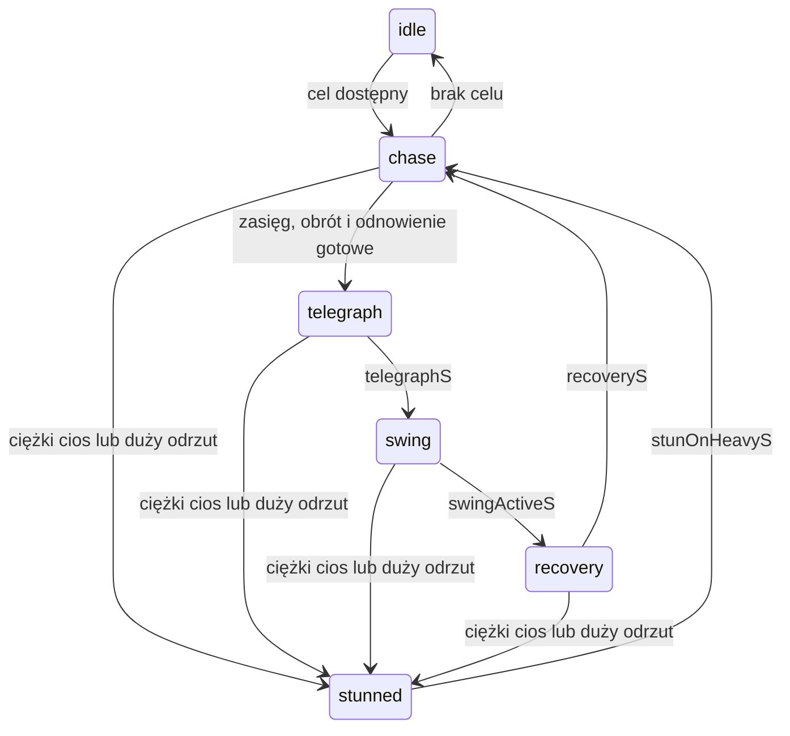

# Wrogowie — F1 #08–09

Szturmowiec (`assaulter`) naciera z pałką elektryczną. Ma 60 HP, porusza się
z prędkością 4,2 m/s, zatrzymuje się 1,8 m od celu i zapowiada cios przez 0,4 s.
Aktywny wymach trwa 0,12 s i zadaje 15 obrażeń przez `Hitbox` oraz `DamageSystem`.
Źródłem zdarzenia `damage_dealt` jest encja wroga. Jeden wymach trafia cel raz;
odejście poza zasięg lub poza obszar przed wrogiem pozwala uniknąć ciosu.

## Dane i rejestr

`src/data/enemies/*.json` ładowane są przez rejestr i walidowane `enemySchema`
z zod. `id` określa wariant, `kind` wybiera implementację archetypu.
`enemyRegistry` to mapa id → fabryka; `availableEnemyIds()` podaje dostępne id,
a `createEnemy(ctx, deps, id, position)` tworzy wroga. Nieznane rodzaje,
powtórzone id i niepoprawne dane zatrzymują ładowanie.

Wspólne pola: `maxHealth`, `moveSpeed`, `turnRateDegS`, `attackRange`,
`telegraphS`, `swingActiveS`, `recoveryS`, `cooldownS`, `damage`,
`knockbackResist` (0–1), `stunOnHeavyS`, `repathJitter`.
Blok `body` zawiera geometrię kapsuły ruchu, hurtboxów i ciosu, odstęp kontrolera
oraz tłumienie odrzutu. Blok `animation` zawiera długość kroku, kąty kończyn,
przechył ogłuszenia i pulsowanie pałki. Te bloki są opcjonalne w schemacie
ogólnym; Szturmowiec wymaga `body`, a jego dane dostarczają również `animation`.
Zdrowie, prędkość oraz obrażenia korzystają ze `Stats`.

## Symulacja i maszyna stanów

`Assaulter` nie importuje Three.js i nie dotyka DOM. `step(dt)` działa w stałym
kroku symulacji; `dt=0` nie zmienia stanu. Snapshoty `previous/current`
przechowują pozycję stóp, yaw, stan, czas stanu, prędkość i przebytą drogę.

Wejście w `telegraph` emituje `enemy_telegraph { id, kind: 'swing', durationS }`.
Kierunek ciosu zostaje ustalony przy zapowiedzi: wróg nie śledzi celu podczas
telegrafu ani wymachu. Zapytanie Rapiera przed wrogiem wybiera hurtbox gracza;
przed trafieniem sprawdzany jest też dystans do aktualnej pozycji celu.
Odnowienie `cooldownS` zaczyna się przy wejściu w `recovery` i biegnie równolegle
z regeneracją po ciosie. Wróg może ponownie zapowiedzieć atak dopiero po obu.

Pościg obraca wroga z ograniczeniem `turnRateDegS`. Promień na wysokości ciała
sprawdza ściany w `tuning.enemies.wallProbe`; przeszkoda wywołuje ruch boczny.
Stronę i odstęp kolejnego sprawdzenia wybiera strumień `Rng.fork('enemy:<id>')`.
`repathJitter` rozprasza momenty kolejnych prób. To lokalne omijanie przeszkód,
bez pathfindingu grafowego. Sąsiedzi z managera odpychają się wewnątrz
`tuning.enemies.separationRadius`; kolizje kapsuł dodatkowo ograniczają nakładanie.
Separacja działa również podczas ataku i ogłuszenia. Gdy spawn umieści kapsuły
w tym samym miejscu, filtr kontrolera pozwala im wyłącznie oddalać się od siebie
do chwili rozdzielenia; później przywraca zwykłe kolizje.

## Wspólne ciało i obrażenia

`EnemyBody` udostępnia ruch po ziemi z grawitacją, próbę ściany i odrzut.
Kinematyczna kapsuła w `CollisionGroup.Enemy` współpracuje z character controllerem
Rapiera. Dwa dodatkowe sensory przyjmują obrażenia: kapsuła tułowia ×1 i kula
głowy ×1,5. Wszystkie collidery są związane z encją przez `EntityRegistry`;
tylko sensory należą do `Hurtboxes`. Ciało i hurtboxy poruszają się razem.
Scena wykonuje **jeden** `world.step()` po krokach gracza i managera.

`damage_dealt` dla własnego id dodaje poziomy impuls z pola `knockback`,
skalowany przez `1 - knockbackResist`, z wykładniczym tłumieniem z danych.
Kierunek pochodzi z `dir`; przy `null` można go odtworzyć z pozycji celu będącego
atakującym. Nieznany kierunek pomija sam odrzut. Tag `PIERCE_BLOCK_TAG`
lub impuls co najmniej `tuning.enemies.stunKnockback` przerywa aktualny atak,
przełącza stan na `stunned` i emituje `enemy_stunned { id, durationS }`.
Ponowne ogłuszenie odświeża czas. Ogłuszony wróg nie atakuje.

Zdarzenie `enemy_killed` z `DamageSystem` przełącza dowolny stan na `dead`.
Wróg przestaje działać i znika wizualnie. Po `tuning.enemies.corpseS` manager
usuwa kontroler, ciało, hurtboxy, rejestrację obrażeń i encję. Zdarzenie śmierci
emituje wyłącznie `DamageSystem`, raz. Odłamki należą do zadania #12.

`EnemyManager`: `spawn(id, position)`, `step(dt)`, `forEach(cb)`, `despawnAll()`,
`dispose()`. Utrzymuje wspólną listę sąsiadów, wywołuje AI i usuwa zwolnione
instancje. Sam nie krokuje świata ani `DamageSystem` — robi to właściciel.

## Render i animacja

`EnemyView` ładuje `enemy_trooper.glb` raz do cache i tworzy niezależny klon
hierarchii dla każdego wroga. Geometria oraz materiały stylu pozostają wspólne;
nie są zwalniane przez pojedynczy widok. Materiały źródłowe GLB są zwalniane po
`applyStyle`. Cache przechowuje jeden szablon na archetyp na czas życia aplikacji.
Brak modelu pozostawia czerwone bryły z analogicznymi pivotami.

Model patrzy w +Z. Pozycja i yaw interpolują się według `alpha`, z najkrótszą
drogą obrotu. Chód wynika z przebytej drogi i obraca `leg_upper_*`, `leg_lower_*`
oraz `arm_upper_*`. Telegraph cofa prawe ramię i zgina łokieć; `baton_tip`
pulsuje skalą względem skali bazowej. Wymach szybko opuszcza ramię, recovery
przywraca pozę, a ogłuszenie przechyla `pelvis`. Bazowe obroty GLB są zachowane.
Animacja pozostaje wyłącznie w renderze i nie steruje trafieniami symulacji.

## Scena ai-test i weryfikacja

`?scene=ai-test&debug=1` zawiera arenę z osłonami `cover_low`, filarem `pillar`
i dwoma Szturmowcami oraz jednym Strzelcem. Konfiguracja sceny jest w `src/data/scenes/aiTest.json`,
walidowana zod. Gracz korzysta z `PlayerController` i `FpsCamera`, ma 100 HP,
hurtbox kapsuły oraz nietykalność po trafieniu z `tuning.damage.playerInvulnMs`.
Napis HTML pokazuje HP. Śmierć resetuje gracza i wrogów po 1 s symulacji;
reset zeruje także okno nietykalności. `dispose` usuwa napis i subskrypcje.

- `spawn <id> [n]`: wróg lub grupa 8 m przed graczem.
- `hit <dmg>`: obrażenia wszystkim wrogom, źródło gracz, tag `#debug`.
- `kill all`: zabija wszystkich przez `DamageSystem`.
- `god`: przełącza `damageTaken` ×0 przez modyfikator `Stats`; działa od razu.
- `reset`: reset sceny przez istniejący mechanizm debug.
- Query: `enemies` (żywi), `enemyStates` (id i stan żywych), `playerHp`.

W 30 sekund: otwórz scenę, pozwól wrogom podejść i odskocz podczas uniesienia
pałki. Oceń czytelność 0,4 s zapowiedzi, ruch wokół filara i okno po ciosie.
Włącz `god`, użyj `spawn assaulter 2`, następnie `hit 1000`; licznik ma spaść do 0.

`tests/unit/enemies.test.ts` korzysta z prawdziwego Rapiera w Node: dane, fabryka,
hurtbox głowy, pościg, czasy ataków, pudło po odejściu, hitstop, odrzut,
ogłuszenie, śmierć, separacja i deterministyczne omijanie ściany.
`aiTest.test.ts` sprawdza scenę, komendy, god, reset po śmierci i sprzątanie.
`enemyView.test.ts` sprawdza interpolację, animację, klonowanie i cache GLB.
`tests/e2e/aiTest.spec.ts` sprawdza ładowanie bez błędów konsoli oraz spawn/kill,
czekając na kroki symulacji przez `waitSimSteps` i `SIM_TIMEOUT`.

## Dodawanie wariantu i archetypu

Wariant istniejącego Szturmowca: dodaj JSON w `src/data/enemies/` z nowym `id`
i `kind: 'assaulter'`, pozostałymi polami, `body` i `animation`. Rejestr wykryje
plik automatycznie; `spawn <nowe-id>` działa bez zmiany kodu zachowania.

Nowy archetyp: rozszerz schemat o potrzebne pola opcjonalne, dodaj
implementację interfejsu `Enemy` i fabrykę dla nowego `kind` w `registry.ts`.
Może korzystać z `EnemyBody`, istniejącego managera i własnego widoku.
Dodaj dane, testy i scenę w zakresie zatwierdzonego zadania. Kontrakty nowych
zdarzeń zatwierdza Architekt w `docs/api.md` przed implementacją.

## Strzelec — F1 #09

`gunner` jest drugim archetypem w rejestrze. `src/data/enemies/gunner.json`
ustala 45 HP, prędkość ruchu 3,4 m/s i preferowany dystans 9 m z tolerancją
2 m (pasmo 7–11 m). Pola dystansowe są opcjonalne dla innych archetypów;
walidator wymaga ich i `body` dla `kind: 'gunner'`. Dane Szturmowca pozostają poprawne.
`maxHealth`, `moveSpeed` i obrażenia pocisku przechodzą przez `Stats`.

Cykl: `idle → reposition → aim → burst → cooldown → reposition`.
Z bliska Strzelec odchodzi, z daleka podchodzi, dodając lekki ruch boczny
(`strafeScale`). Stronę i rozrzut wybiera wyłącznie własny strumień
`Rng.fork('enemy:<id>')`. Korzysta z `EnemyBody`, separacji sąsiadów oraz
istniejącej próby ściany `tuning.enemies.wallProbe`.

W paśmie z widocznym celem zatrzymuje się i emituje
`enemy_telegraph { id, kind: 'aim', durationS: 0.5 }`. Przez całe 0,5 s
celuje i obraca się do gracza, dopiero potem oddaje trzy strzały co 0,22 s
(z dokładnością do stałego kroku). Każdy strzał mierzy w aktualną pozycję celu
z rozrzutem ±2° na osiach yaw i pitch. Po serii odpoczywa 1,6 s.
Ogłuszenie przerywa zapowiedź lub serię; obsługa odrzutu, śmierci i usuwania
ciała jest taka jak u Szturmowca.

Przy `losRequired: true` raycast Rapiera sprawdza `CollisionGroup.World`
od ciała do wylotu i od wylotu do celu. Brak widoczności przerywa celowanie
lub serię i kieruje Strzelca do celu w stanie `reposition`. Odcinek do wylotu
zapobiega strzelaniu przez osłonę, w którą wszedł model karabinu.

Scena przekazuje wspólny `ProjectileSystem` w `EnemyDependencies.projectiles`
(wymagany przy tworzeniu Strzelca). Pocisk ma `team: 'enemy'`, właściciela
równego id Strzelca, tag `#gun`, prędkość **11 m/s**, obrażenia **12** i czas
życia 4 s. Po `reflect(id, playerId, 'player', dir)` może zranić Strzelca.
Wylot symulacji określa lokalny wektor `muzzle` w danych; nie zależy od renderu.

`EnemyView` ładuje i klonuje `enemy_gunner.glb`, stosuje `applyStyle` i zachowuje
czerwony fallback z karabinem i wizjerem. Chód korzysta z przebytej drogi.
Celowanie unosi oba ramiona i utrzymuje poziom karabinu; widoczny `visor`
oraz węzeł `muzzle` pulsują. `shotTimeS` w snapshotach uruchamia odrzut
`rifle`, także po ostatnim strzale serii. Parametry animacji są w JSON.

`ai-test` ma jedną pulę pocisków i `ProjectileRenderer` z `InstancedMesh`.
Scena krokuje pociski po `world.step()`, render interpoluje pozycje i ustawia
orientację wzdłuż lotu. Pociski wrogów używają `enemy_projectile.glb`,
`enemyGlow` i skali 1,6; przy braku modelu pozostaje większa bryła zastępcza.
Reset czyści aktywne pociski, a dispose usuwa pulę i zasoby renderu.

Kontrola w 30 sekund: `?scene=ai-test&debug=1&seed=gunner`, `kill all`,
`spawn gunner 1`. Sprawdź pulsowanie wizjera przed serią, widoczność wolnych
pocisków i możliwość zejścia z toru lotu. Podejdź bliżej niż 7 m, potem odejdź
ponad 11 m; wróg powinien odzyskać dystans. Osłoń się filarem — nie powinien
strzelać przez ścianę. `god` pozwala obserwować kolejne serie bez śmierci.

Testy Rapiera w `enemies.test.ts` obejmują dane obu archetypów, dystans,
zapowiedź, serię, LOS, prędkość i obrażenia pocisku, odbicie, deterministyczność
oraz przerwanie serii przez ogłuszenie. `aiTest.test.ts` sprawdza pociski sceny
i ich czyszczenie przy resecie, a `enemyView.test.ts` — osobny cache Strzelca,
celowanie, pulsowanie i odrzut. Playwright `aiTest.spec.ts` sprawdza
`spawn gunner 1` oraz utratę HP od pocisków z wyłączonym `god`, czekając
na kroki symulacji przez `waitSimSteps` i `SIM_TIMEOUT`.
